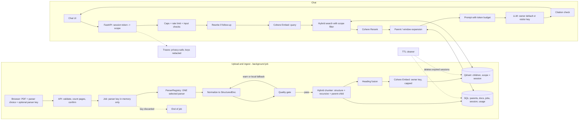

# RAG Portfolio Project: Architecture (Portfolio Edition v2.1, hybrid access + BYOK for parser and LLM)

> Three access tiers: **(A) try it with no keys** on a pre-indexed demo corpus · **(B) upload your own PDF** with the free local parser or your own parser key · **(C) bring your own LLM key** so answers cost you nothing · **Cohere for both embeddings and reranking** (owner key, hard caps) · one parser per job · recursive splitting combined with parent-child chunking · heading fusion · hybrid search · cited answers · per-session isolation · evaluated on a golden set

This is the trimmed, buildable version of the full production architecture. It keeps the parts that show RAG quality and engineering judgment, and defers the rest to a documented production roadmap.

---

## 0. Changelog (vs. Portfolio Edition v2)

| # | Change | Why |
|---|---|---|
| 1 | **Hybrid access model with three tiers** (A: no keys, B: own parser key or local parser, C: own LLM key too) | A reviewer can use the demo in seconds; engineers can go deeper with their own documents and keys |
| 2 | **BYOK scope fixed to exactly two services: the PDF parser and the LLM** (both optional) | The person who chooses an expensive or open-ended step pays for it; everything else stays simple |
| 3 | **Cohere is the single provider for embeddings (Embed) and reranking (Rerank)**, one owner key, hard caps | One account, models designed to work together, no embedding-model mismatch for visitors |
| 4 | **Vector DB is the owner's Qdrant**, scope-filtered, TTL auto-delete | No user-supplied URLs (so no SSRF surface), and deletion works without any visitor credential |
| 5 | **Owner spend controls are back** (per-session and daily caps, kill switch, hard provider budgets) | The owner pays for embeddings, reranking and default-LLM answers |
| 6 | **New LLM key rules:** the LLM key travels on every chat request (stateless, request-scoped), the parser key only for the job | Chat needs the LLM key each turn; neither key is ever stored |
| 7 | **Fixed provider egress allowlist** (adapters call only hard-coded provider hosts) | Replaces the SSRF guard that full BYOK would have needed |
| 8 | **Embedding model is pinned** (`embedding_version`); changing it means re-indexing the demo corpus and expiring sessions | Query and document vectors must come from the same model |
| 9 | **Tracing policy:** full traces only for dev/eval and demo-corpus queries; metadata-only for visitor uploads | Visitor document text never lands in the owner's observability tools |
| 10 | **Demo video in the README** | Many reviewers will not try any mode |

Unchanged: recursive + parent-child chunking algorithm, heading fusion, hybrid search, `IReranker` interface, window expansion with token budget, citation check, not-found gate, quality gate, per-session isolation.

### Decisions that are now settled

| Question | Decision |
|---|---|
| Who pays for embeddings and reranking? | **Owner**, via one Cohere key with hard per-session and daily caps |
| Who pays for the answer LLM? | **Owner by default (tight cap); visitor if they supply their own LLM key** |
| Who pays for parsing? | **The visitor** (own parser key) or nobody (free local parser) |
| Who hosts vectors? | **Owner's Qdrant**, `scope` filter, TTL deletion |
| Can visitors point the app at their own URLs? | **No** (keeps the system free of SSRF risk) |

---

## 1. Goals

| Goal | How it's met |
|---|---|
| **Instant demo, no setup** | Tier A: chat over a pre-indexed demo corpus with example questions |
| **Use with your own documents** | Tier B/C: upload → choose parser → (optional parser key) → chat |
| **Show real RAG skill** | Pluggable parser layer, recursive + parent-child chunking, hybrid search, Cohere reranking, citations, "not found" behavior |
| **Prove it works** | Golden set with recall and faithfulness numbers, plus an ablation table |
| **Stay cheap and safe** | Parser and optional LLM cost on the visitor's key; owner services capped; strict upload limits; TTL cleanup |
| **Show you know production** | README maps every cut feature to its production design |

---

## 2. Scope: what's in, what's out

| In scope (build it) | Out of scope (list as future work) |
|---|---|
| **Three access tiers** (no keys / own parser key or local parser / own LLM key) | Accounts, logins, billing |
| **User-selectable parser (LlamaParse / Landing AI / Unstructured) behind `IParser`, BYOK, one parser per job; free local parser** | Automatic multi-parser fallback or ensembles |
| **Optional BYOK LLM (two hosted providers) behind `ILLM`** | Visitor-supplied vector DB, custom endpoints, bring-your-own embedder or reranker |
| Normalization to a common `StructuredDoc` + quality gate | Durable distributed queue and worker fleet |
| Background ingestion job with status endpoint | Versioned collections, blue/green re-indexing |
| Hybrid chunker: headings + recursive splitter + parent-child | Semantic cache |
| Heading fusion (`embedding_text` vs `display_text`) | Local-LLM summarizer, VLM for tables/charts |
| **Cohere Embed + Cohere Rerank** (owner key, capped), hybrid search (dense + sparse) in Qdrant filtered by scope | Full guardrail stack (PII, output groundedness model) |
| Parent/window expansion with a token budget | Self-hosted GPU serving |
| Citations that link to the source passage | Scalability and concurrency hardening |
| Per-session isolation, upload limits, TTL deletion, usage meter | Full SLO monitoring and alerting |
| Owner spend caps, rate limits, kill switch | Formal security audit |
| Golden-set evaluation, Langfuse tracing (privacy-safe) | |

---

## 3. System Overview

### 3.1 Access tiers

| Tier | Visitor provides | Can do | Who pays what |
|---|---|---|---|
| **A: Try it** | Nothing | Chat over the demo corpus (`scope = "demo"`, read-only) | Owner: query embedding, rerank, LLM answers (tight per-session and per-IP caps) |
| **B: Upload** | A PDF + free local parser **or** own parser key | Upload, parse, index, chat over own documents (and the demo corpus) | Visitor: parsing (own key). Owner: embedding, rerank, LLM answers within caps |
| **C: Full control** | B + **own LLM key** | Same as B, with answers generated on the visitor's LLM key and higher question limits | Visitor: parsing + answers. Owner: embedding + rerank within caps |

### 3.2 Flow diagram

```
UPLOAD & INGEST (online, background job per document; tiers B and C)
┌──────────────────────────────────────────────────────────────────────────────────┐
│ Browser: pick PDF + parser (+ parser key, or free local parser)                  │
│   → API: validate file, count pages, show estimate, user confirms                │
│   → Job created (parser key held in memory only) → ParserRegistry selects ONE    │
│   → Normalize to StructuredDoc → Quality gate (warn / optional local fallback)   │
│   → Hybrid Chunker (structure + recursive + parent-child) + Heading Fusion       │
│   → Cohere Embed (owner key, capped) → Qdrant (scope = session) · parents → SQL  │
│   → Parser key discarded when the job ends                                       │
└──────────────────────────────────────────────────────────────────────────────────┘

CHAT (online; tiers A, B and C)
┌──────────────────────────────────────────────────────────────────────────────────┐
│ Chat UI → FastAPI (session token → scope; optional LLM key in request header) →  │
│ caps + rate limits + input checks → (follow-up? rewrite) → Cohere Embed (query) →│
│ Hybrid Search (scope filter) → Cohere Rerank → Parent/Window Expansion →         │
│ Prompt (token budget) → LLM (owner default OR visitor key) → citation check      │
└──────────────────────────────────────────────────────────────────────────────────┘

CROSS-CUTTING: session isolation · TTL cleanup · key redaction · owner spend caps ·
               privacy-safe tracing · evaluation
```



---

## 4. Upload and ingestion (online, one parser per job)

### 4.1 User flow

1. Visitor opens the app and gets a **session token** (random, server-issued, HTTP-only cookie or bearer token). They can **chat with the demo corpus immediately** (tier A).
2. To use their own document, the visitor chooses **a PDF**, selects **one parser** from a dropdown, and either pastes **their own parser key** or picks **"Use free local parser"** (no key).
3. The server validates the file, counts pages **locally**, and shows: *"This will parse about N pages using your <parser> key and use about M of your K free document chunks. Continue?"*
4. On confirm, the server creates a **job** and returns `job_id`. The UI polls status (`queued → parsing → chunking → embedding → indexing → ready | failed`).
5. When `ready`, the visitor chats over their documents and the demo corpus. They may **optionally paste their own LLM key** to raise question limits and use their own model.
6. A usage meter shows how much of the session's free allowance (documents, chunks, questions) remains.

### 4.2 Pipeline steps (per document)

| # | Step | Details |
|---|---|---|
| 1 | **Validate upload** | Magic-byte check (real PDF), extension, max file size, max pages, max documents per session, max total pages per session, reject encrypted/password-protected files with a clear message |
| 2 | **Count pages and confirm** | Local page count (no API call); show the page usage on the visitor's parser key and the share of the session's owner-funded embedding allowance the document will consume |
| 3 | **Create job** | Store job metadata (id, session scope, filename hash, parser *name*, status). **The parser key is not stored**; it lives in memory for the job's lifetime only (§8) |
| 4 | **Parse** | `ParserRegistry.get(parser_name).parse(file, api_key)` for the single selected parser. Use the session-scoped parse cache if the same `(session, content_hash, parser, parser_version)` exists |
| 5 | **Normalize** | Parser-specific normalizer → common `StructuredDoc` (§4.3.2) |
| 6 | **Quality gate** | Local checks (§4.3.3). On failure: mark `quality_warning`, tell the visitor which checks failed and suggest trying another parser; optionally re-parse once with the free local parser |
| 7 | **Chunk** | Hybrid chunker (§4.4) → parents + children |
| 8 | **Fuse** | `embedding_text` = breadcrumb + child text; `display_text` stays clean |
| 9 | **Embed + store** | Batch-embed children with **Cohere Embed** (`input_type` for documents; owner key; counted against the session's chunk cap); compute sparse vectors locally; upsert to Qdrant with `scope = session_id`; write parents/documents to SQL |
| 10 | **Validate and finish** | Assert size caps and coverage; set status `ready`; **discard the parser key**; log only non-secret stats (counts, timings, parser name, chunks embedded) |

If the process restarts mid-job, the job is marked `failed: interrupted` and any partial vectors for that job are deleted by `doc_id` (the key was memory-only, so the visitor re-submits). Concurrency is limited (for example 1-2 simultaneous jobs; others stay `queued`), which keeps a small host stable. Chunk IDs are deterministic, so re-submitting never duplicates vectors.

### 4.3 Parser layer (visitor-selected, one at a time)

```text
ParserRegistry = {
  "llamaparse":        LlamaParseAdapter,       # needs visitor key
  "landingai":         LandingAIAdapter,        # needs visitor key
  "unstructured_api":  UnstructuredAPIAdapter,  # needs visitor key
  "unstructured_local":UnstructuredLocalAdapter,# open-source mode, no key (optional)
  "local_pymupdf":     LocalReferenceAdapter    # no key; basic text + headings heuristics
}
IParser.parse(pdf_path, api_key | None) -> RawParseResult
Normalizer.to_structured(raw) -> StructuredDoc
```

Adding a fourth parser later means one new adapter and one new normalizer; nothing else changes. Each cloud adapter calls only its provider's fixed host (§8).

#### 4.3.1 The selectable parsers

| Parser | Typical output | Good for | Watch for |
|---|---|---|---|
| **LlamaParse** | Markdown (headings, tables) | General layout, simple to consume | Cloud API: document text goes to the provider; page/credit usage on the visitor's key |
| **Landing AI** | Typed regions (text, table, figure), page/coordinate grounding, Markdown | Tables, figures, citation highlighting | Cloud API; different output schema |
| **Unstructured** (hosted API or local open-source) | Typed elements (Title, NarrativeText, ListItem, Table, Header/Footer…) | Element typing; local mode needs no key | Heading levels not always explicit; headers/footers must be dropped |
| **Local (PyMuPDF-based)** | Plain text with simple heading heuristics | Free option, quality-gate reference | Weak on tables and complex layouts |

Output formats, parameters, limits and pricing change. Verify each provider's current documentation and key requirements before building the adapters. A "Test key" button (one cheap call or a documented validation endpoint, if the provider offers one) gives the visitor fast feedback on a wrong key.

#### 4.3.2 Normalization to `StructuredDoc`

Every adapter maps its output to the same typed block list, so the chunker never knows which parser was used:

```text
StructuredDoc {
  doc_id, title, page_count, parser_used, parser_version,
  blocks: [
    Block {
      type:   heading | paragraph | list_item | table | code | figure | caption
      text:   cleaned text (tables also carry a Markdown rendering)
      level:  1..6 for headings (else null)
      page:   page number
      bbox:   optional coordinates (for citation highlighting)
      order:  reading-order index
    }
  ]
}
```

| Source | Mapping |
|---|---|
| LlamaParse Markdown | `#` headings → `heading(level)`, pipe tables → `table`, list markers → `list_item`, rest → `paragraph`; page numbers from page markers/metadata if provided |
| Landing AI regions | Text → `paragraph`/`heading` (headings from Markdown or region labels), table → `table`, figure → `figure` (keep caption); carry page and coordinates into `page`/`bbox` |
| Unstructured elements | Title → `heading` (level from depth metadata if present, else inferred, default 2), NarrativeText → `paragraph`, ListItem → `list_item`, Table → `table` (convert to Markdown), Header/Footer/PageNumber → **dropped** |
| Local PyMuPDF | Font-size/boldness heuristics → headings; remaining text → paragraphs |

Common clean-up: remove repeated headers/footers, fix hyphenated line breaks, normalize whitespace and unicode, drop empty blocks.

#### 4.3.3 Quality gate (warn, don't silently continue)

Cheap local checks against a plain text extraction of the PDF:

| Check | Flags when |
|---|---|
| **Text coverage** | Much less text than the reference extraction (content lost), or large duplicated spans |
| **Heading sanity** | Zero headings in a long document, an implausible share of heading blocks, erratic level jumps |
| **Table integrity** | Tables in the reference but none in the output, or rows with inconsistent column counts |
| **Empty pages** | Pages with text in the reference but no blocks in the output |
| **Garbled text** | High share of replacement/non-text characters |

Behavior: the job still finishes, but the document shows a **"Parse quality warning"** with the failed checks and the suggestion *"Try re-uploading with a different parser."* If free local fallback is enabled and coverage is very low, re-parse once locally. Thresholds are set by testing on a handful of your own PDFs, not guessed.

### 4.4 Hybrid chunking: recursive splitting + parent-child

| Layer | Decides | Mechanism |
|---|---|---|
| **Structure-aware** (typed blocks, headings) | *Where* to cut | Heading stack; tables, code, list items stay whole |
| **Recursive splitter** | *How big* pieces may be | Token-based separator cascade `\n\n` → `\n` → sentence end → space, with overlap |
| **Parent-child** | *What to search vs. what the LLM reads* | Small children embedded and retrieved; larger parents stored once as context |

#### 4.4.1 Configuration (starting values, tune on your golden set)

| Parameter | Default |
|---|---|
| `child_target_tokens` / `child_max_tokens` | 300 / 450 |
| `child_min_tokens` (merge smaller) | 120 |
| `child_overlap` (only when a paragraph is split) | 12% |
| `parent_target_tokens` / `parent_max_tokens` | 1,000 / 1,500 |
| `fallback_parent_tokens` (no-heading documents) | 1,000 |
| `table_max_tokens` (split by rows, header repeated) | 800 |
| `prefix_max_tokens` (breadcrumb) | 60 |
| `parent_expand_max_tokens` (query time) | 1,200 |
| `window_neighbors` | 1 |
| `tokenizer` | the Cohere embedding model's tokenizer, or a safe approximation with a margin below the model's max input |

#### 4.4.2 Algorithm

```text
INPUT : StructuredDoc (typed blocks), config
OUTPUT: parents[], children[]   (every child links to exactly one parent)

1. STRUCTURE PASS
   Walk blocks in reading order, keeping a heading stack:
     heading(level L) -> set stack[L], clear deeper levels
   Tag every non-heading block with the breadcrumb "H1 > H2 > H3".
   Edge cases: skipped levels, headings with no body (skip),
   repeated headings (keep order index), no headings (go to 2b).

2. PARENT CONSTRUCTION
   a) Group blocks under the same lowest heading -> section.
      section_tokens <= parent_max -> one parent.
      section_tokens >  parent_max -> RECURSIVE split at block/paragraph
         boundaries into sub-parents of ~parent_target tokens.
         Never split inside a table, list item or code block.
   b) No-heading documents: fixed-size parents of ~fallback_parent_tokens;
      breadcrumb = document title or filename.

3. CHILD CONSTRUCTION (inside each parent)
   a) Atomic blocks:
        table -> one child if <= table_max, else split by rows,
                 header row repeated in every piece
        code / list item -> keep whole when possible
   b) Text blocks: merge consecutive small paragraphs up to ~child_target;
      pieces below child_min merge into the nearest sibling
   c) Oversized text (> child_max): RECURSIVE splitter
        cascade  \n\n -> \n -> sentence end -> space,
        target child_target, overlap child_overlap
   d) Assign chunk_index within the parent; set prev_chunk_id / next_chunk_id

4. HEADING FUSION (per child)
   display_text   = original child text (answers and citations)
   embedding_text = "<breadcrumb>\n\n<child text>"   (prefix capped at prefix_max)

5. VALIDATION
   - child_tokens <= child_max; parent_tokens <= parent_max
   - every child has a parent_id; no empty or duplicate chunks
   - children together cover the document text (no silent loss)
```

Only children are embedded. Parents are stored once as plain text in SQL.

---

## 5. Chat pipeline

| # | Step | Details |
|---|---|---|
| 1 | **Chat UI** | Question box, streamed answer, collapsible source cards, example-question chips (for the demo corpus), usage meter, optional "Use my own LLM key" field |
| 2 | **FastAPI** | `POST /chat`; request ID; **session token → `scope` derived on the server**; optional LLM key read from a request header into a request-scoped context; per-IP and per-session rate limits; max question length; **owner-spend caps** (§9) |
| 3 | **Input checks** | Length and character limits; light prompt-injection screen; the question is never treated as instructions for tools |
| 4 | **Rewrite (conditional)** | Only with chat history: one cheap LLM call makes the follow-up standalone. Skipped on first turns. Uses the same LLM (owner default or visitor key) |
| 5 | **Embed query** | **Cohere Embed** with the query `input_type`; same pinned model as the index (`embedding_version` checked) |
| 6 | **Hybrid search** | Dense + locally computed sparse query in Qdrant, fused with RRF, **with a mandatory filter `scope IN [session_id, "demo"]`** set by the server (clients can never supply filters). Top 30-50 child chunks |
| 7 | **Cohere Rerank** | Rerank candidates' `embedding_text`; keep top 5. Behind an `IReranker` interface; owner key, counted against the session's rerank cap |
| 8 | **Not-found gate** | If the best rerank score is below a threshold chosen from the golden set, answer "I couldn't find this in the documents" and stop (before any LLM call, which also saves cost) |
| 9 | **Parent / window expansion** | Parent ≤ `parent_expand_max` → whole parent; else child plus one neighbor each side. Dedupe overlaps; stop at the context budget (about 3,000-4,000 tokens, capped by the active LLM's context window). Parent fetch is by `parent_id` **and** `scope` |
| 10 | **Prompt + LLM** | Answer only from the numbered context, cite source IDs, say "not found" if unsupported; context is delimited and labeled untrusted; output tokens capped. LLM is the **visitor's** (if a key was supplied) or the **owner's default** |
| 11 | **Citation check** | Verify every cited ID was in the context; drop or flag invalid citations; show breadcrumb + page for each source |

**Fallbacks:** if Cohere Rerank errors or times out (short timeout, one retry for transient errors), fall back to hybrid-search order and flag the response. If Cohere Embed fails at query time, return a friendly "search temporarily unavailable". If the LLM errors, return the sources with a "generation unavailable" message. A **visitor key error** (invalid, quota exhausted) is reported clearly and never retried; the visitor can continue with the owner's default LLM within caps.

**Streaming note:** stream for speed and run the citation check at the end.

---

## 6. Data stores

| Store | Choice | Holds |
|---|---|---|
| **Vector DB** | Owner's Qdrant Cloud (free tier) or local Docker; native dense + sparse hybrid | Child chunk vectors + payload, each tagged with `scope` (payload-indexed) |
| **SQL** | SQLite for simplest hosting, or free-tier Postgres | `sessions`, `jobs`, `documents`, `parents`, `parse_cache` |
| **Uploaded files** | Temporary local storage (or bucket) | Source PDFs, deleted by the TTL cleaner |

**Child chunk (Qdrant payload):**

```json
{
  "chunk_id": "c_ab12…",
  "scope": "s_7f3c…",
  "doc_id": "d_07",
  "title": "My Report",
  "breadcrumb": "My Report > Risks > Supply Chain",
  "page": 14,
  "bbox": [72, 310, 520, 402],
  "chunk_type": "text | table",
  "display_text": "…clean child text…",
  "embedding_text": "My Report > Risks > Supply Chain\n\n…child text…",
  "child_tokens": 312,
  "parent_id": "p_ab12…",
  "chunk_index": 2,
  "prev_chunk_id": "c_ab11…",
  "next_chunk_id": "c_ab13…",
  "content_hash": "sha256:…",
  "parser_used": "llamaparse",
  "parser_version": "<recorded>",
  "embed_provider": "cohere",
  "embed_model": "<model name>",
  "embedding_version": "emb-v1",
  "chunking_version": "hybrid-v1"
}
```

**SQL tables:**

| Table | Columns |
|---|---|
| `sessions` | `session_id`, `created_at`, `expires_at`, `tier`, `pages_used`, `docs_count`, `chunks_embedded`, `rerank_calls`, `questions_owner_llm`, `questions_own_llm`, `owner_tokens_used`, `request_count` |
| `jobs` | `job_id`, `session_id`, `doc_id`, `parser_name`, `status`, `error_message` (sanitized), `pages`, `chunks`, `quality_flags`, `started_at`, `finished_at` — **no key column** |
| `documents` | `doc_id`, `session_id`, `title`, `content_hash`, `page_count`, `parser_used`, `parser_version`, `quality_flags`, `chunking_version`, `embedding_version`, `ingested_at` |
| `parents` | `parent_id`, `doc_id`, `session_id`, `breadcrumb`, `text`, `token_count`, `page_start`, `page_end` |
| `parse_cache` | `session_id`, `content_hash`, `parser`, `parser_version`, `raw_result_blob`, `created_at` — **session-scoped, never shared across sessions** |
| `usage_daily` | `date`, `chunks_embedded`, `rerank_calls`, `owner_llm_tokens`, `jobs` — **global counters for the daily cap and kill switch** |

The shared **demo corpus** uses `scope = "demo"`, is ingested once by you (with your own keys, offline), and is read-only for visitors. If `embedding_version` changes, the demo corpus is re-embedded and all visitor sessions are expired (they are short-lived anyway).

---

## 7. Technology stack

| Layer | Choice | Why |
|---|---|---|
| Language / API | Python + FastAPI (BackgroundTasks or a small in-process job runner) | Standard for RAG; simple hosting |
| **Parsing** | **LlamaParse, Landing AI, Unstructured (API or local)** via `ParserRegistry`; local PyMuPDF free option | Visitor picks one per document; no vendor lock-in |
| Chunking | Custom Python (heading stack + token-based recursive splitter + parent-child) | Showcase piece; fully testable |
| **Embeddings** | **Cohere Embed** (owner key, capped; document vs query input types) | Hosted, no GPU, one provider with the reranker |
| Sparse / keyword | FastEmbed sparse model or BM25 via Qdrant, **computed locally** | Hybrid search without a second database or extra API |
| Vector DB | Owner's Qdrant | Native hybrid search, free cloud tier |
| **Reranker** | **Cohere Rerank** (via `IReranker`, same Cohere key, capped) | High quality; swappable later |
| **LLM** | **Owner default:** any cheap hosted LLM (capped). **BYOK:** two hosted providers behind `ILLM` | Default keeps the demo working; BYOK removes your answer cost |
| SQL | SQLite / Postgres | Simple |
| Tracing | Langfuse (dev/eval and demo-corpus queries with content; metadata-only for visitor uploads), **with redaction** | Screenshot-ready traces, no secrets, no visitor text |
| Evaluation | Ragas or a custom script | Recall@k, MRR, faithfulness |
| Frontend | Next.js on Vercel, or Streamlit/Gradio | Fast to build and host |
| Hosting | Render / Fly / Railway (API), Vercel or HF Spaces (UI) | Free or low-cost tiers |

Free-tier limits, pricing, trial-key terms and rate limits change often. **Check Cohere's current terms before launch**, in particular whether a trial key is allowed for a public demo; if not, use a production key with a hard budget. Do the same for the LLM, Qdrant, Langfuse and each parser.

**Interfaces to keep:**

```text
IParser      parse(file, api_key|None) -> RawParseResult
Normalizer   to_structured(raw) -> StructuredDoc        (one per parser)
IChunker     chunk(structured_doc, config) -> {parents[], children[]}
IEmbedder    embed(texts[], input_type) -> vectors[]     (Cohere, owner key)
IVectorStore upsert / hybrid_search(filter) / delete_by_scope / delete_by_doc
IReranker    rerank(query, candidates) -> scored[]       (Cohere, owner key)
ILLM         generate(prompt, api_key|None) -> stream    (owner default or visitor key)
```

---

## 8. API key handling

There are two kinds of keys. **Owner keys** (Cohere, default LLM, Qdrant, Langfuse) live only in environment variables or a secret manager. **Visitor keys** (parser, LLM) pass through your server and are treated as secrets at every step.

| Rule | Implementation |
|---|---|
| **HTTPS only** | Reject non-TLS requests; set HSTS on the hosted app |
| **Parser key: job-scoped memory only** | Read from the upload request, passed to the job in process memory, used for the provider calls, discarded when the job ends or fails. **Never written to SQL, files, cache, queue payloads or environment** |
| **LLM key: request-scoped memory only** | Sent in a request header on each chat call, held in a request-scoped context, destroyed when the request ends. Never written anywhere |
| **Secret type** | Keys are wrapped in a `Secret` type whose string/JSON/log representation is `***`; the real value is only read at the provider call |
| **Not in logs** | Logging middleware strips `Authorization` and key fields; exception handlers redact; error messages shown to visitors never echo a key |
| **Not in traces** | Redact keys in Langfuse spans and any request/response capture; adapter inputs containing keys are never attached |
| **Not in URLs** | Header or request body only, never a query string |
| **Not in browser storage by default** | Keep keys in frontend state only; optional "remember in this tab" is off by default |
| **Not in cache keys or shared state** | Parse-cache keys use the content hash and parser name, never the key. Cache is session-scoped |
| **Fixed egress allowlist** | Each adapter calls only its provider's hard-coded host(s); there are **no visitor-supplied URLs or base URLs**, so there is no SSRF surface. If custom endpoints are ever added, add an SSRF guard (HTTPS only, block private/loopback/metadata ranges, no open redirects) first |
| **Least privilege** | Tell visitors in the UI to use a **limited, revocable key** and to revoke it afterward |
| **Clear disclosure** | Short privacy note next to each key field: *"This key is used only to call <provider> for this request, held in memory, and not stored. Your document or question text is sent to <provider>."* |
| **Provider errors handled** | Map invalid key, quota exhausted, rate limit and timeout to friendly messages; **never retry visitor-key errors**; bounded backoff only for owner-key rate limits |
| **Cost guard (visitor keys)** | Page count shown and confirmed before parsing; max pages per document and per session; output-token cap on LLM calls |
| **Honest limit** | Because visitor keys transit your server, using tiers B/C with a key requires trust in the host. State this in the README. Tier A needs no key |

---

## 9. Safety, cost and abuse protection

### 9.1 Owner spend controls (the owner pays for Cohere and the default LLM)

| Control | Detail (starting values, tune after launch) |
|---|---|
| **Hard provider budgets** | Monthly spend limits set in the Cohere and LLM provider consoles **before launch** |
| **Per-session caps** | e.g. chunks embedded ≈ 1,500; rerank calls ≈ 30; **owner-LLM questions ≈ 10-20**; **own-LLM-key questions ≈ 100**; max documents ≈ 3 |
| **Per-IP caps** | Rate limit per minute; daily questions per IP; daily uploads per IP |
| **Daily global caps** | Chunks embedded, rerank calls, owner-LLM tokens, jobs; when reached, the app switches to **"demo at capacity"** (demo-corpus Q&A only or read-only message) |
| **Kill switch** | Config flag that disables uploads and/or owner-LLM answers instantly without redeploying |
| **Cheapest-first ordering** | Not-found gate runs before the LLM; output-token cap; context budget cap; no LLM call for refused questions |
| **Alerts** | Notification at 50% and 80% of daily/monthly budget |

### 9.2 Other risks

| Risk | Control |
|---|---|
| **Malicious or oversized uploads** | Magic-byte check, size and page limits, document and page caps per session, reject encrypted files, never execute or render uploaded content on the server beyond parsing, run parsing with timeouts |
| **Cross-visitor data leakage** | Server-derived `scope` on every Qdrant query and SQL read; parse cache and files scoped per session; automated isolation tests; demo scope read-only |
| **Leftover user data** | TTL cleaner deletes expired sessions: vectors by `scope`, SQL rows, cached parses and files; also a **"Delete my data now"** button (works with no key because the vectors are in the owner's Qdrant) |
| **Bot / abuse traffic** | Per-IP and per-session rate limits, question length cap, optional lightweight CAPTCHA before upload |
| **Prompt injection** (documents and questions) | Context labeled untrusted and delimited; instructions say to ignore commands inside documents; reject obvious injection patterns in the question; citation check |
| **Copyright / privacy** | Visitors upload their own documents; terms state they must have the right to upload; documents go to the parser provider they chose, text to Cohere (embeddings/rerank) and the active LLM provider |
| **Secrets** | Owner keys in environment variables or a secret manager; visitor keys per §8; nothing in the repo |
| **Cold starts** | Show a "waking up" message; jobs survive only while the process runs (interrupted jobs are marked failed) |

---

## 10. Evaluation

### 10.1 Golden set
Write **40-60 questions** over your **demo corpus**, each with the document and section that answer it. Include direct fact lookups, table/number questions, questions needing two sections, and questions whose answer is **not** in the corpus.

### 10.2 Metrics

| Metric | Measures |
|---|---|
| Recall@5 / Recall@10 | Did the right chunk or section appear? |
| MRR | How high did it rank? |
| Faithfulness | Is the answer supported by the retrieved context? (LLM-judge, spot-checked by hand) |
| Not-found accuracy | Does it correctly refuse unanswerable questions? |
| Latency p50 / p95 | From traces |
| Cost per query | From provider usage (Cohere embed + rerank + LLM tokens) |

### 10.3 Chunking and retrieval ablation table (README)

| Configuration | Recall@5 | MRR | Faithfulness |
|---|---|---|---|
| Recursive splitting only, dense search | | | |
| + hybrid (dense + sparse) | | | |
| + heading-aware parent-child chunking (recursive inside) | | | |
| + heading fusion | | | |
| + Cohere Rerank | | | |
| + window expansion / token budget | | | |

### 10.4 Tier checks
Run a short scripted check for each tier (A: no keys; B: local parser; C: own LLM key) confirming the flow works, caps trigger, and the correct party's key is used for each call.

### 10.5 Optional parser comparison (dev-time, one parser at a time)

If you want a README table, ingest the same 10-20 sample PDFs **separately** with each parser (using your own keys, one run per parser), keep everything else fixed, and record the results. This is optional and never part of the live flow.

| Parser | Quality-gate pass % | Heading accuracy | Table fidelity | Recall@5 | MRR | Time/doc | Cost/100 pp |
|---|---|---|---|---|---|---|---|
| LlamaParse | | | | | | | |
| Landing AI | | | | | | | |
| Unstructured | | | | | | | |

Fill every table with **your own measured numbers**. If a step or parser doesn't help on your data, say so.

---

## 11. Repository structure

```
rag-portfolio/
├── README.md                  # demo video, diagram, tiers, results tables, privacy note, trace screenshot
├── demo_corpus/               # public documents for the shared demo scope
├── samples/                   # extra sample PDFs for testing and "load sample" button
├── src/
│   ├── interfaces.py          # IParser, IChunker, IEmbedder, IVectorStore, IReranker, ILLM
│   ├── ingest/
│   │   ├── parsers/
│   │   │   ├── registry.py        # ParserRegistry (name -> adapter)
│   │   │   ├── llamaparse.py      # adapter + normalizer
│   │   │   ├── landingai.py       # adapter + normalizer
│   │   │   ├── unstructured.py    # API + local adapters + normalizer
│   │   │   ├── local_pymupdf.py   # no-key parser and quality-gate reference
│   │   │   ├── structured_doc.py  # StructuredDoc / Block
│   │   │   ├── quality_gate.py
│   │   │   └── cache.py           # session-scoped parse cache
│   │   ├── upload.py          # validation, page count, limits, estimate
│   │   ├── jobs.py            # job runner, status, parser-key lifecycle (memory only)
│   │   ├── chunk.py           # structure pass, parents, children, recursive splitter
│   │   ├── fuse.py            # heading fusion
│   │   ├── embed.py           # Cohere Embed adapter + local sparse
│   │   └── store.py           # Qdrant adapter
│   ├── retrieval/             # search.py (scope filter), rerank.py (Cohere), expand.py
│   ├── generation/            # prompt.py, llm.py (owner default + BYOK adapters), citations.py
│   ├── security/              # secret.py, sessions.py, redaction.py, limits.py, caps.py, killswitch.py, ttl_cleaner.py
│   └── api/                   # main.py (FastAPI): /session /connections/test /upload /jobs/{id} /chat /usage /delete
├── eval/
│   ├── golden_set.jsonl
│   ├── run_eval.py
│   ├── tier_checks.py         # A / B / C scripted checks
│   ├── parser_compare.py      # optional, one parser per run
│   └── results/
├── tests/
├── frontend/                  # tier A landing, upload form (file + parser + key), optional LLM key, usage meter
├── docker-compose.yml
└── .env.example               # owner keys only (Cohere, default LLM, Qdrant, Langfuse) + cap settings
```

**API endpoints:** `POST /session`, `POST /connections/test` (parser key or LLM key, no data stored), `POST /upload` (file, parser name, parser key in header or body), `GET /jobs/{id}`, `POST /chat` (optional LLM key header), `GET /usage`, `DELETE /session` (delete my data).

**Tests worth writing:**
- **Key redaction:** a fake parser key and fake LLM key never appear in logs, error messages, traces, SQL, cache or responses (grep the captured output).
- **Egress allowlist:** adapters refuse any host other than their provider's.
- **Session isolation:** session A can never retrieve session B's chunks or parents; client-supplied filters are ignored; demo scope is read-only.
- **Owner caps:** per-session, per-IP, daily and kill-switch limits trigger and show friendly messages; owner-LLM is never called after the cap.
- **Tiers:** A works with no keys; B works with the local parser and with a (mocked) parser key; C uses the visitor LLM key and never the owner's.
- **TTL cleaner** removes vectors, SQL rows, cache and files for an expired session; delete-my-data works without a key.
- **Upload limits:** wrong magic bytes, oversize, too many pages, encrypted files, per-session caps.
- **Embedding consistency:** a changed `embedding_version` is detected and refused at query time.
- Each normalizer produces a valid `StructuredDoc` from a saved sample of that parser's raw output (no API call needed).
- **Parser selection:** the chosen parser is the only one invoked; an invalid key yields a friendly error with no retry storm.
- Chunk size caps never exceeded; tables never split mid-row; oversized sections become sub-parents; no-heading documents get fixed-size parents; every child has a parent; children cover the text.
- Quality gate flags a broken parse and passes a good one.
- Interrupted job is marked failed and leaves no partial index; re-submit does not duplicate vectors.

---

## 12. Build plan (summary; see the execution roadmap for task-level detail)

| Phase | Deliverable | Done when |
|---|---|---|
| 0 | Decisions, repo, capped owner accounts, sample data | CI green; budgets set on Cohere and LLM keys |
| 1 | Key safety and provider layer (secret type, redaction, key transport, egress allowlist, test-connection) | Redaction and allowlist tests pass |
| 2 | Parser adapters + normalizers + local parser + quality gate | One `StructuredDoc` format for all parsers |
| 3 | Chunker, Cohere Embed, Qdrant, demo corpus ingested | Chunks, parents and breadcrumbs inspected by hand |
| 4 | Hybrid search, Cohere Rerank, expansion, LLM (owner + BYOK), citations, not-found gate; CLI | Cited answers in a terminal |
| 5 | API, sessions, demo mode (tier A), owner spend caps and kill switch | Anyone can chat on the demo with no keys; caps enforced |
| 6 | Upload flow, jobs, parser key lifecycle, TTL cleaner, isolation tests (tiers B/C) | Visitor can upload and chat; keys never leak in tests |
| 7 | Golden set, eval, ablation table, thresholds, privacy-safe tracing | Real metrics and a trace screenshot |
| 8 | Frontend (tier landing, upload, optional LLM key, usage meter) | Full flow works in the browser |
| 9 | Hardening: abuse, failure drills, security review | Drills and security checklist pass |
| 10 | Deployment and smoke tests | Public link works on a phone and survives a cold start |
| 11 | README, demo video, launch | Project understandable from the README alone |

If time is short, protect this order: **key safety + owner caps → pipeline → demo mode → upload flow → golden-set numbers → deployment → polish.** Ship with one cloud parser (plus local) and one BYOK LLM provider fully tested rather than more half-tested.

---

## 13. README checklist

- [ ] One-paragraph pitch, **live demo link** and **demo video/GIF** at the top
- [ ] Explanation of the three tiers (what you can do with no keys, with a parser key, with an LLM key)
- [ ] Architecture diagram (Mermaid above or an exported image)
- [ ] "Why these choices": hybrid access model, BYOK limited to parser and LLM, Cohere for embedding + rerank, quality gate, combined recursive + parent-child chunking, hybrid search
- [ ] **"Bring your own key" guide** for the two key types (where to get them, suggested limited permissions)
- [ ] **Privacy and key-handling note** (what is sent where, what is stored: nothing about the keys)
- [ ] **Ablation table with your own numbers** (and the optional parser comparison)
- [ ] Langfuse trace screenshot (showing keys are redacted) and a short latency/cost summary
- [ ] Example questions, including a "not found" case
- [ ] Limitations (honest list)
- [ ] **Production roadmap** (table below)

---

## 14. Production roadmap (what you cut, and what it would become)

| Cut for the demo | Production design |
|---|---|
| In-process job runner | Object storage → events → durable queue with retries and dead-letter queue → stage workers; keys delivered via a secrets/vault mechanism with short-lived tokens |
| Session scope without accounts | Real auth, tenants, ACL fields on every chunk, ACL pre-filter, ACL-scoped cache |
| Per-session caps instead of billing | Accounts with plans, per-tenant quotas, usage metering and billing |
| Owner-held Cohere key for everyone | Per-tenant keys or a managed gateway with budgets, optionally BYO embedder/reranker with embedding-version management |
| Visitor LLM key per request | Encrypted vault with short-lived tokens, or SSO to an organization-managed gateway |
| Re-upload to change parser | Versioned documents and collections, dual-write, blue/green alias swap |
| Warn on bad parse | Automatic multi-parser routing with budgets and circuit breakers (for organizations holding several keys) |
| Simple injection screen | Input/output guardrail models, context sanitization, PII handling |
| No cache | ACL-scoped semantic cache with single-flight coalescing |
| No summaries | Local-LLM document summaries as an extra context prefix, kept only if ablation shows gain |
| Hosted LLM only | LLM gateway with routing, fallback and self-hosted GPU serving |
| Basic tracing | Full metrics, SLO alerting, per-tenant cost tracking |
| No load testing | Burst, chaos and noisy-neighbor tests; per-tenant quotas; concurrency fixes (compare-and-swap versions, per-document ordering) |

---

## 15. Known risks for this project

| Risk | Mitigation |
|---|---|
| **Owner-paid Cohere and default LLM get drained by visitors** | Hard provider budgets, per-session/per-IP/daily caps, kill switch, "demo at capacity" mode, alerts |
| **Visitor keys transit your server** (trust and liability) | §8 rules, redaction tests, clear disclosure, advise limited revocable keys, never persist; tier A needs no key |
| **Cohere trial-key terms may not allow a public demo** | Check current terms before launch; use a production key with a hard budget if required |
| **Embedding model change breaks retrieval** | Pin `embedding_version`, check at query time, re-embed demo corpus and expire sessions on change |
| Uploads open the door to abuse (large files, junk, malware) | Strict validation and limits, session caps, timeouts, TTL deletion, rate limits, optional CAPTCHA |
| Cross-session leakage | Server-derived scope on every query, isolation tests, session-scoped cache, read-only demo scope |
| Three parsers means three vendors: formats, limits and terms change | Adapters isolated behind `IParser`, saved raw samples for tests, verify current docs, ship fewer parsers if needed |
| Normalization bugs from differing parser outputs | One `StructuredDoc` contract, normalizer unit tests |
| Heading levels missing from Unstructured output | Level inference with a safe default, quality gate warning |
| Bad parse silently hurts answers | Quality warning shown to the visitor, suggest another parser, optional local fallback |
| Visitor content ends up in your observability tools | Metadata-only traces for uploads, content traces only for dev and demo corpus |
| Jobs lost on restart (ephemeral hosting) | Mark interrupted jobs failed, delete partial vectors, deterministic chunk IDs, visitor re-submits |
| Defaults (chunk sizes, thresholds, caps) wrong for your corpus | Tune on the golden set and first week of usage; report what you chose and why |
| Over-building | Follow the scope table; add features only after the golden-set numbers exist |
