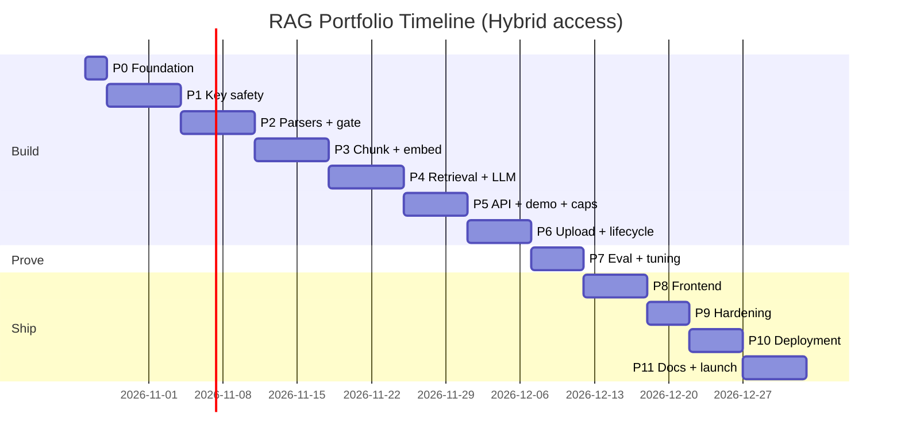

# RAG Portfolio Project: Execution Roadmap v3 (Hybrid access, BYOK for parser + LLM, Cohere for embed + rerank)

> **Three tiers:** (A) try it with no keys · (B) upload your own PDF with the free local parser or your own parser key · (C) bring your own LLM key too.
> **BYOK = parser and LLM only.** **Cohere (Embed + Rerank) uses one owner key with hard caps.** Vector DB is the owner's Qdrant.
> Planned start: **Mon 26 Oct 2026** · Target public launch: **~1 Jan 2027** · Buffer: **until 8 Jan**
> Assumes ~15-20 focused hours/week. Stretch or compress dates to fit your schedule (the end-of-year holidays may need extra buffer).
> Companion document: `RAG_Architecture_Portfolio_v2.1_Hybrid.md`

## What changed vs. roadmap v2 (full BYOK)

| # | Change | Consequence |
|---|---|---|
| 1 | **BYOK reduced to two services: parser and LLM** (both optional) | No visitor embedder, reranker or vector-DB keys; wizard shrinks to a simple form |
| 2 | **Cohere handles both embeddings and reranking** on one owner key | One account; embedding model is pinned, so no model-mismatch flow for visitors |
| 3 | **Vector DB is the owner's Qdrant** | No SSRF guard needed (no user URLs); TTL and "Delete my data" work with no visitor key |
| 4 | **New: Tier A demo mode** (no keys, pre-indexed demo corpus) | New tasks for demo ingestion, read-only scope, example questions |
| 5 | **Owner spend controls restored and expanded** (per-session, per-IP, daily caps, kill switch, hard provider budgets) | New dedicated Phase 5 tasks and Phase 9 drills |
| 6 | **Egress allowlist** instead of SSRF guard | Adapters can only call fixed provider hosts |
| 7 | **LLM key on every chat request** (stateless) while the parser key is job-scoped | Two key lifecycles, both tested |
| 8 | **Privacy-safe tracing policy** | Content traces only for dev/eval and demo corpus |
| 9 | **Demo video** added as a launch deliverable | New Phase 11 task |

## How to use this file

- **Task IDs** (`P3-T4`) are used in `Depends on:` lines, so you can paste them into Jira/Notion/GitHub as ticket keys.
- Each `☐` subtask is sized **15-60 min**; the estimate is in brackets, e.g. `[30m]`.
- 🔴 **CRITICAL** = do not skip; the project is unsafe, broken or not credible without it.
- **Priority:** P0 = must ship · P1 = should ship · P2 = nice to have (cut first if time is short).
- **Complexity:** Low / Medium / High (effort and risk, not hours).
- Protection order if time is short: **key safety + owner caps → pipeline → demo mode → upload flow → golden-set numbers → deployment → polish.**

## Access tiers and who pays

| Tier | Visitor provides | Can do | Owner pays | Visitor pays |
|---|---|---|---|---|
| **A: Try it** | Nothing | Chat over demo corpus | Query embed, rerank, LLM (tight caps) | Nothing |
| **B: Upload** | PDF + local parser or own parser key | Upload, parse, index, chat | Embed, rerank, LLM (caps) | Parsing (own key) |
| **C: Full control** | B + own LLM key | Same as B, own model, higher question limit | Embed, rerank (caps) | Parsing + answers |

## Phase overview

| Phase | Name | Dates | Priority | Complexity |
|---|---|---|---|---|
| 0 | Foundation & Decisions | Oct 26-27 | P0 | Low |
| 1 | Key Safety & Provider Layer | Oct 28 - Nov 3 | P0 | High |
| 2 | Parser Layer, Normalization & Quality Gate | Nov 4-10 | P0 | High |
| 3 | Chunker, Cohere Embeddings & Indexing | Nov 11-17 | P0 | High |
| 4 | Retrieval (Cohere Rerank) & Generation, CLI | Nov 18-24 | P0 | High |
| 5 | API, Sessions, Demo Mode & Owner Cost Controls | Nov 25-30 | P0 | High |
| 6 | Upload Flow, Jobs & Data Lifecycle | Dec 1-6 | P0 | High |
| 7 | Evaluation, Tuning & Tracing | Dec 7-11 | P0 | Medium |
| 8 | Frontend | Dec 12-17 | P0 | Medium |
| 9 | Hardening, Abuse & Failure Drills | Dec 18-21 | P0 | Medium |
| 10 | Deployment & Production Readiness | Dec 22-26 | P0 | Medium |
| 11 | Documentation, Demo Video & Launch | Dec 27 - Jan 1 | P0 | Low |
| - | Buffer / slip | Jan 2-8 | - | - |

---

# Phase 0: Foundation & Decisions

**Goal:** Lock the access-model decisions, create the repo skeleton, and open your owner accounts with spend limits set before any code touches them.

**Deliverables:**
- Decision log (tiers, BYOK scope, caps, providers)
- Repo with structure, CI, secret scanning
- Capped owner accounts (Cohere, default LLM, Qdrant, Langfuse) and dev keys for parsers
- Sample PDFs and a chosen demo corpus

## Checklist

☐ **P0-T1 🔴 Lock scope and decisions** (P0)
  ☐ [30m] Confirm the three tiers and who pays for what (table above)
  ☐ [30m] Confirm **BYOK = parser + LLM only**; Cohere Embed + Rerank on the owner key; owner-run Qdrant; **no visitor-supplied URLs**
  ☐ [30m] Choose key transport: parser key per upload request (job-scoped), LLM key per chat request header (request-scoped); both memory-only
  ☐ [30m] Pick v1 providers: **2 cloud parsers + local**, **owner default LLM + 2 BYOK LLM providers**
  ☐ [30m] Choose hosting (API, UI) and SQL (SQLite vs Postgres)
  ☐ [30m] Write initial cap values (placeholders) and record everything in `docs/DECISIONS.md`

☐ **P0-T2 Create repo and skeleton** (P0) · *Depends on: P0-T1*
  ☐ [30m] Repo, `.gitignore` (`.env`, uploads, caches), LICENSE, README stub
  ☐ [45m] Folders from the architecture §11
  ☐ [45m] `src/interfaces.py` with `IParser`, `IChunker`, `IEmbedder`, `IVectorStore`, `IReranker`, `ILLM` as abstract classes
  ☐ [30m] Tooling: `pyproject.toml`, ruff, black, mypy (loose), pytest with a placeholder test

☐ **P0-T3 CI and secrets hygiene** (P0) · *Depends on: P0-T2*
  ☐ [45m] GitHub Actions: lint + tests on every push
  ☐ [30m] Secret-scanning pre-commit hook (gitleaks)
  ☐ [20m] `.env.example` with owner keys and cap settings only
  ☐ [20m] Verify `.env` is ignored

☐ **P0-T4 🔴 Owner accounts and hard budgets** (P0) · *Depends on: P0-T1*
  ☐ [45m] Create **Cohere** account; read current terms and limits; **confirm a trial key is allowed for a public demo, otherwise plan for a production key**
  ☐ [30m] Create default-LLM account and key
  ☐ [30m] **Set monthly spend limits and alerts on Cohere and the LLM before any code uses the keys**
  ☐ [30m] Create Qdrant Cloud free cluster; (optional) Langfuse project
  ☐ [45m] Create your own dev keys for the parsers and BYOK LLM providers you will support
  ☐ [30m] Read each provider's docs: auth, test call, rate limits, model names, embedding dimension, input types

☐ **P0-T5 Sample data and demo corpus** (P1) · *Depends on: P0-T1*
  ☐ [45m] Collect 5-10 varied PDFs (clean, tables, no headings, multi-column, scan-like)
  ☐ [45m] Choose 3-5 public documents for the **demo corpus**; confirm redistribution rights
  ☐ [30m] Store in `demo_corpus/` and `samples/` with source/licence notes

☐ **P0-T6 Project board** (P1)
  ☐ [45m] Import this roadmap; one epic per phase
  ☐ [15m] Labels: P0/P1/P2, Critical, Blocked

Priority: **P0** · Complexity: **Low**

**Milestone:**
✅ Repo builds in CI, decisions written down, all owner keys have spend limits and are out of git.

---

# Phase 1: Key Safety & Provider Layer

**Goal:** Build the secret-handling and provider-abstraction foundation for the two visitor-supplied keys (parser, LLM) and the owner keys, before any real adapter exists.

**Deliverables:**
- `Secret` type, redaction middleware, key transport
- Interfaces + registries; fixed egress allowlist
- Error taxonomy and retry policy
- Test-connection for parser key and LLM key
- Security test suite in CI

## Checklist

☐ **P1-T1 🔴 Secret type and redaction** (P0) · *Depends on: P0-T2*
  ☐ [45m] `Secret` wrapper whose `str`/`repr`/JSON output is `***`; real value only via explicit `.reveal()`
  ☐ [45m] Logging filter/middleware stripping `Authorization`, key headers and any `*key*`/`*token*`/`*secret*` fields
  ☐ [30m] Exception handler redaction; visitor-facing errors never echo keys
  ☐ [45m] Tests: fake keys never appear in logs, exceptions or responses

☐ **P1-T2 Config model: owner keys vs visitor keys** (P0) · *Depends on: P1-T1*
  ☐ [45m] `OwnerConfig` (Cohere, default LLM, Qdrant, Langfuse, cap values) loaded from env only
  ☐ [30m] `VisitorKeys {parser?, llm?}` request-scoped model; tier detection from which keys are present
  ☐ [30m] Provider catalog (small JSON/YAML): parsers and BYOK LLMs with docs links and notes
  ☐ [30m] Unit tests for validation (unknown provider, missing key where required)

☐ **P1-T3 Interfaces and registries** (P0) · *Depends on: P1-T2*
  ☐ [45m] `IParser.parse(file, api_key|None)` and `ILLM.generate(prompt, api_key|None)`; owner-key adapters (`IEmbedder`, `IReranker`) read from `OwnerConfig`
  ☐ [30m] Registries: parsers, LLMs
  ☐ [30m] `docs/ADDING_A_PROVIDER.md` (one adapter + one catalog entry)

☐ **P1-T4 🔴 Key transport and lifecycle** (P0) · *Depends on: P1-T1, P1-T2*
  ☐ [45m] Parser key from upload request header/body, never query string
  ☐ [45m] LLM key from a chat request header into a request-scoped context destroyed at request end
  ☐ [45m] Background jobs receive the parser key in process memory only and discard it in `finally`
  ☐ [30m] Reject non-TLS in production; HSTS
  ☐ [30m] Tests: no key persisted in SQL, files, cache or queue payloads

☐ **P1-T5 🔴 Fixed egress allowlist** (P0) · *Depends on: P1-T3*
  ☐ [45m] HTTP client wrapper that only permits hard-coded provider hosts per adapter
  ☐ [30m] Set connect/read timeouts and response-size caps; disable redirects to other hosts
  ☐ [30m] Tests: adapter refuses any other host (including `localhost` and private IPs)
  ☐ [15m] Note in `DECISIONS.md`: custom endpoints are out of scope; add an SSRF guard first if ever introduced

☐ **P1-T6 Error taxonomy and retry policy** (P0) · *Depends on: P1-T3*
  ☐ [30m] Errors: `InvalidKey`, `QuotaExhausted`, `RateLimited`, `Timeout`, `ModelNotFound`, `ProviderError`
  ☐ [45m] Friendly message mapping with no raw provider payloads
  ☐ [45m] **Visitor-key errors: never retry.** Owner-key rate limits: bounded exponential backoff, honor `Retry-After`, circuit breaker after repeated failures
  ☐ [30m] Tests with simulated errors

☐ **P1-T7 Test-connection for visitor keys** (P0) · *Depends on: P1-T3, P1-T6*
  ☐ [45m] Parser key check (documented validation endpoint or smallest possible call; avoid burning pages)
  ☐ [45m] LLM key check (tiny completion, confirm model exists)
  ☐ [30m] `POST /connections/test` returns `ok | error_code | hint`; never stores or echoes the key

☐ **P1-T8 Security suite in CI** (P0) · *Depends on: P1-T4, P1-T5, P1-T7*
  ☐ [45m] Grep-based test: fake parser key and fake LLM key never appear in captured logs/responses
  ☐ [30m] Wire redaction and allowlist tests as required CI checks

Priority: **P0** · Complexity: **High**

**Milestone:**
✅ Redaction and egress-allowlist tests pass in CI; test-connection works for both key types against your dev keys.

---

# Phase 2: Parser Layer, Normalization & Quality Gate

**Goal:** Turn any PDF into a common `StructuredDoc` using the **one parser the visitor selected**, and flag bad parses.

**Deliverables:**
- `StructuredDoc` / `Block` schema
- Adapters + normalizers for the chosen cloud parsers + local PyMuPDF
- Quality gate with tuned thresholds
- Saved raw parser outputs as test fixtures

## Checklist

☐ **P2-T1 🔴 Define `StructuredDoc` contract** (P0) · *Depends on: P1-T3*
  ☐ [45m] `Block` (type, text, level, page, bbox, order) and `StructuredDoc` (doc_id, title, page_count, parser_used, parser_version, blocks)
  ☐ [30m] Validation (unique reading order, heading level 1-6, no empty blocks)
  ☐ [30m] Unit tests

☐ **P2-T2 Local PyMuPDF parser (no key)** (P0) · *Depends on: P2-T1*
  ☐ [60m] Per-page text with font size/bold metadata
  ☐ [45m] Heading heuristics (font-size ranking → levels 1-3)
  ☐ [30m] Header/footer removal; map to `StructuredDoc`
  ☐ [30m] Tests on 3 sample PDFs

☐ **P2-T3 Adapter + normalizer #1 (e.g. LlamaParse)** (P0) · *Depends on: P2-T1, P1-T5, P1-T6*
  ☐ [45m] Read current provider docs (output format, limits)
  ☐ [60m] Adapter using the visitor's key through the egress wrapper; timeout; no retry on key/quota errors
  ☐ [30m] Run once with your dev key; **save raw outputs as fixtures**
  ☐ [60m] Normalizer: `#` → heading(level), pipe tables → table, lists → list_item, page markers → page
  ☐ [45m] Normalizer tests from fixtures (no API calls)

☐ **P2-T4 Adapter + normalizer #2 (e.g. Unstructured or Landing AI)** (P0) · *Depends on: P2-T1, P1-T5, P1-T6*
  ☐ [45m] Read provider docs
  ☐ [60m] Adapter (same error handling and egress rules)
  ☐ [30m] Save raw fixtures
  ☐ [60m] Normalizer (Title → heading with inferred level default 2, drop Header/Footer/PageNumber, tables → Markdown; or regions with page/bbox)
  ☐ [45m] Normalizer tests from fixtures

☐ **P2-T5 Optional third parser** (P2) · *Depends on: P2-T3, P2-T4*
  ☐ [120m] Adapter + normalizer + tests
  ☐ [15m] Decision gate: skip if behind schedule; mark "planned" in README

☐ **P2-T6 Common clean-up** (P1) · *Depends on: P2-T3*
  ☐ [45m] Remove repeated headers/footers
  ☐ [30m] Fix hyphenation, normalize whitespace/unicode, drop empty blocks; tests

☐ **P2-T7 🔴 Quality gate** (P0) · *Depends on: P2-T2, P2-T3*
  ☐ [45m] Text coverage vs local reference extraction
  ☐ [30m] Heading sanity (none in long doc, erratic level jumps)
  ☐ [45m] Table integrity checks
  ☐ [30m] Empty-page and garbled-text checks
  ☐ [45m] Tune thresholds on your sample PDFs; record in `DECISIONS.md`
  ☐ [45m] Tests: flags a broken parse, passes a good one

☐ **P2-T8 Page counting and local fallback** (P1) · *Depends on: P2-T2*
  ☐ [30m] Local page counter (no API call)
  ☐ [45m] Optional "re-parse locally once if coverage very low" path

Priority: **P0** · Complexity: **High**

**Milestone:**
✅ One `StructuredDoc` format for all selected parsers; fixtures pass; quality gate catches bad parses.

---

# Phase 3: Chunker, Cohere Embeddings & Indexing

**Goal:** Chunk documents (recursive + parent-child + heading fusion), embed them with **Cohere Embed on the owner key**, index into the owner's Qdrant, and ingest the demo corpus.

**Deliverables:**
- `chunk.py`, `fuse.py`, `embed.py` (Cohere + local sparse), `store.py` (Qdrant)
- SQL schema with usage counters and no key columns
- Pinned `embedding_version` and a re-embed script
- Demo corpus ingested under `scope = "demo"`

## Checklist

☐ **P3-T1 🔴 Chunker: structure pass** (P0) · *Depends on: P2-T1*
  ☐ [45m] Heading stack with breadcrumb tagging (skipped levels, empty headings, repeats)
  ☐ [30m] Config object with sizes from the architecture §4.4.1
  ☐ [45m] Tokenizer: Cohere model tokenizer or approximation with a safety margin; verify chunks never exceed the model's max input
  ☐ [30m] Tests for nested/skipped headings

☐ **P3-T2 Parent construction** (P0) · *Depends on: P3-T1*
  ☐ [45m] Sections by lowest heading
  ☐ [60m] Oversized sections → recursive split into sub-parents; never split tables/lists/code
  ☐ [45m] No-heading documents → fixed-size parents
  ☐ [30m] Tests for each case

☐ **P3-T3 Child construction + recursive splitter** (P0) · *Depends on: P3-T2*
  ☐ [60m] Token-based recursive splitter with overlap
  ☐ [45m] Merge small paragraphs; merge under-min pieces
  ☐ [60m] Tables: whole if small, else split by rows with header repeated
  ☐ [30m] `chunk_index`, `prev/next_chunk_id`; **deterministic chunk IDs** (hash of doc + position)
  ☐ [45m] Tests: size caps, no mid-row table splits

☐ **P3-T4 Heading fusion and validation** (P0) · *Depends on: P3-T3*
  ☐ [30m] `embedding_text` = breadcrumb + child; `display_text` clean
  ☐ [45m] Validation: every child has a parent, no empties/duplicates, text coverage
  ☐ [30m] Manual inspection script on 3 PDFs

☐ **P3-T5 🔴 Cohere Embed adapter** (P0) · *Depends on: P3-T4, P1-T5, P1-T6, P0-T4*
  ☐ [60m] Adapter with **document vs query input types**, provider batch limits, truncation setting; owner key from config
  ☐ [45m] Bounded backoff for rate limits, circuit breaker on repeated failure
  ☐ [30m] Record model name and vector dimension; fail fast if unexpected
  ☐ [45m] Local sparse vectors (FastEmbed/BM25), no API
  ☐ [30m] Usage counter hooks (chunks embedded) for caps in Phase 5

☐ **P3-T6 🔴 Qdrant store with scope** (P0) · *Depends on: P3-T5*
  ☐ [45m] Create collection (dense + sparse) and **payload index on `scope` and `doc_id`**
  ☐ [45m] `upsert` (idempotent by chunk ID), `hybrid_search(filter)`, `delete_by_scope`, `delete_by_doc`
  ☐ [30m] Payload matches architecture §6 (including `embed_model`, `embedding_version`, `chunking_version`)
  ☐ [30m] Integration test against Qdrant Cloud/Docker

☐ **P3-T7 SQL schema (no keys)** (P0) · *Depends on: P0-T2*
  ☐ [60m] Tables: `sessions` (with usage counters), `jobs`, `documents`, `parents`, `parse_cache`, `usage_daily`
  ☐ [30m] Migration/setup script
  ☐ [30m] Parent fetch by `parent_id` **and** `scope`
  ☐ [30m] Test: schema contains no key columns; no secret ever written

☐ **P3-T8 Embedding version pinning** (P0) · *Depends on: P3-T6, P3-T7*
  ☐ [30m] `embedding_version` constant stored in payload and documents
  ☐ [45m] Query-time check: refuse (clear error) if the index version differs from the configured one
  ☐ [45m] `scripts/reembed_demo.py` to rebuild the demo corpus and expire sessions when the version changes

☐ **P3-T9 Demo corpus ingestion (offline)** (P0) · *Depends on: P3-T6, P3-T7, P2-T3*
  ☐ [45m] Ingestion script (your own keys) writing `scope = "demo"`
  ☐ [30m] Verify counts in Qdrant vs SQL; spot-check 10 chunks
  ☐ [30m] Draft 8-10 example-question chips for the demo corpus

Priority: **P0** · Complexity: **High**

**Milestone:**
✅ Chunks, parents and breadcrumbs inspected by hand; demo corpus indexed with Cohere vectors and searchable with scope filter.

---

# Phase 4: Retrieval (Cohere Rerank) & Generation, CLI

**Goal:** Cited answers from the terminal: embed query → hybrid search → Cohere Rerank → not-found gate → expansion → LLM (owner default or visitor key) → citation check.

**Deliverables:**
- `retrieval/` (search, rerank, expand) and `generation/` (prompt, llm, citations)
- Owner-default LLM adapter + two BYOK LLM adapters
- CLI Q&A and fallback behaviors

## Checklist

☐ **P4-T1 🔴 Hybrid search with mandatory scope filter** (P0) · *Depends on: P3-T6, P3-T8*
  ☐ [45m] Embed query with Cohere (query input type), dense + sparse, RRF fusion, top 30-50
  ☐ [30m] Filter `scope IN [session_id, "demo"]` set by server code only; **function has no client-filter parameter**
  ☐ [30m] Tests: other scope returns nothing

☐ **P4-T2 Cohere Rerank behind `IReranker`** (P0) · *Depends on: P4-T1*
  ☐ [60m] Adapter (same Cohere key); keep top 5
  ☐ [45m] Short timeout, one retry for transient errors, fallback to hybrid order with a response flag
  ☐ [30m] Usage counter hook (rerank calls)
  ☐ [30m] Test fallback with a simulated outage

☐ **P4-T3 Not-found gate (stub threshold)** (P0) · *Depends on: P4-T2*
  ☐ [30m] Refuse when best rerank score is below a configurable threshold, **before any LLM call**
  ☐ [15m] Placeholder value; real value set in Phase 7

☐ **P4-T4 Parent/window expansion with budget** (P0) · *Depends on: P4-T2, P3-T7*
  ☐ [45m] Parent ≤ expand max → whole parent; else child ± 1 neighbor
  ☐ [45m] Context budget capped by the active LLM's context window; dedupe overlaps
  ☐ [30m] Tests: budget never exceeded; scope honored

☐ **P4-T5 LLM adapters (owner default + BYOK)** (P0) · *Depends on: P4-T4, P1-T3, P1-T5*
  ☐ [60m] Owner-default LLM adapter with streaming and **output-token cap**
  ☐ [60m] BYOK LLM adapter #1 (visitor key, request-scoped)
  ☐ [60m] BYOK LLM adapter #2
  ☐ [45m] Numbered, delimited, **untrusted** context prompt; ignore commands inside documents
  ☐ [30m] "Generation unavailable" fallback that still returns sources; visitor-key errors reported without retry

☐ **P4-T6 🔴 Citation check** (P0) · *Depends on: P4-T5*
  ☐ [45m] Verify every cited ID exists in the context; drop/flag invalid
  ☐ [30m] Attach breadcrumb + page to each source
  ☐ [30m] Tests with fabricated IDs

☐ **P4-T7 Conditional query rewrite** (P1) · *Depends on: P4-T5*
  ☐ [45m] One cheap rewrite call (same LLM), only for follow-ups
  ☐ [30m] Tests on 3 follow-up examples

☐ **P4-T8 CLI Q&A** (P0) · *Depends on: P4-T6*
  ☐ [45m] `python -m src.cli ask "question"` printing answer, sources, timings and token usage
  ☐ [45m] Ask 15 questions with the **owner LLM** and again with a **BYOK LLM key**; log differences in `docs/ISSUES.md`
  ☐ [30m] Include 3 unanswerable questions and one run with Cohere Rerank disabled

Priority: **P0** · Complexity: **High**

**Milestone:**
✅ Cited answers in the terminal with owner and BYOK LLMs; unanswerable questions refused; rerank failure degrades gracefully.

---

# Phase 5: API, Sessions, Demo Mode & Owner Cost Controls

**Goal:** Expose the pipeline as a safe API where anyone can chat on the demo corpus with no keys (Tier A), with every owner-paid call capped.

**Deliverables:**
- FastAPI: `/session`, `/connections/test`, `/chat`, `/usage`
- Sessions with server-derived scope
- Per-session, per-IP and daily caps, kill switch, "demo at capacity" mode
- Demo mode tests

## Checklist

☐ **P5-T1 🔴 Sessions and server-derived scope** (P0) · *Depends on: P3-T7, P1-T4*
  ☐ [45m] `POST /session` issues a random token (HTTP-only cookie or bearer)
  ☐ [30m] Middleware maps token → `scope`; never trusts client scope/filters
  ☐ [30m] Expiry (`expires_at`), tier detection, counters in SQL

☐ **P5-T2 🔴 Owner cost caps** (P0) · *Depends on: P5-T1, P3-T5, P4-T2*
  ☐ [60m] Per-session caps: chunks embedded, rerank calls, owner-LLM questions, own-LLM-key questions, documents (atomic counter updates)
  ☐ [45m] Per-IP rate limits and daily per-IP questions/uploads
  ☐ [45m] Daily global caps (`usage_daily`) for chunks, rerank calls, LLM tokens, jobs
  ☐ [45m] **"Demo at capacity" mode** when a global cap is hit (friendly message, demo-corpus read-only or paused)
  ☐ [30m] Tests: caps trigger; owner LLM is never called after its cap

☐ **P5-T3 🔴 Kill switch and budget guards** (P0) · *Depends on: P5-T2*
  ☐ [45m] Config flags to disable uploads and/or owner-LLM answers instantly (no redeploy)
  ☐ [30m] Alert hooks at 50% and 80% of daily/monthly budget (email/webhook)
  ☐ [30m] Re-verify provider-side hard budgets on Cohere and the LLM

☐ **P5-T4 Demo mode (Tier A)** (P0) · *Depends on: P5-T1, P4-T8, P3-T9*
  ☐ [45m] Chat works with no keys over `scope = "demo"` (read-only)
  ☐ [30m] Stricter demo limits (questions per session/IP)
  ☐ [30m] `GET /examples` endpoint serving the example-question chips
  ☐ [30m] Test: demo scope cannot be written to by visitors

☐ **P5-T5 Chat endpoint with optional LLM key** (P0) · *Depends on: P5-T2, P4-T6, P1-T4*
  ☐ [45m] `POST /chat`: request ID, optional LLM key header, tier-based limits (higher with own key)
  ☐ [30m] Max question length; light prompt-injection screen
  ☐ [30m] If the visitor key fails (invalid/quota), report clearly and offer the owner default within caps
  ☐ [30m] `GET /usage` returns remaining allowance for the meter

☐ **P5-T6 Privacy-safe logging in chat paths** (P0) · *Depends on: P5-T5*
  ☐ [30m] Log only metadata (request ID, tier, timings, counts); no question or document text for uploaded scopes
  ☐ [30m] Re-run the key-leak grep test against `/chat` and `/connections/test`

☐ **P5-T7 Start isolation tests** (P1) · *Depends on: P5-T5*
  ☐ [45m] Session A cannot read B's chunks or parents
  ☐ [30m] Client-supplied filters ignored

Priority: **P0** · Complexity: **High**

**Milestone:**
✅ Anyone can chat on the demo corpus with no keys via the API; caps, "at capacity" mode and the kill switch work.

---

# Phase 6: Upload Flow, Jobs & Data Lifecycle

**Goal:** Let a visitor upload a PDF (Tiers B and C), choose a parser (own key or local), ingest into their session scope, and delete everything, without key leakage or cross-session mixing.

**Deliverables:**
- `/upload`, `/jobs/{id}`, `DELETE /session`
- Job runner with parser-key lifecycle
- Parse cache, TTL cleaner
- Full isolation and key-leak suites

## Checklist

☐ **P6-T1 🔴 Upload validation** (P0) · *Depends on: P5-T1, P2-T8*
  ☐ [45m] Magic-byte check, extension, max size
  ☐ [30m] Reject encrypted PDFs with a clear message
  ☐ [30m] Max pages per document, documents and total pages per session
  ☐ [45m] Tests for every rejection

☐ **P6-T2 Estimate and confirm** (P0) · *Depends on: P6-T1, P1-T7*
  ☐ [45m] Local page count and chunk estimate; show parser-page usage on the visitor key and share of the session's free chunk allowance
  ☐ [30m] Parser-key "Test key" check before confirm
  ☐ [30m] Separate confirm step before any provider call

☐ **P6-T3 🔴 Job runner and parser-key lifecycle** (P0) · *Depends on: P6-T2, P3-T4, P2-T7, P5-T2*
  ☐ [60m] In-process runner, concurrency 1-2, others queued
  ☐ [45m] States: queued → parsing → chunking → embedding → indexing → ready | failed
  ☐ [60m] Parser key in memory for the job only; discarded in `finally`
  ☐ [60m] Pipeline: parse → normalize → quality gate → chunk → fuse → Cohere embed (cap-checked) → upsert with `scope`
  ☐ [45m] Interrupted job → `failed: interrupted`; delete partial vectors by `doc_id`; re-submit is idempotent (deterministic IDs)
  ☐ [30m] Provider errors mapped to friendly messages; no retry storms on the visitor key

☐ **P6-T4 Quality warning and local fallback** (P1) · *Depends on: P6-T3*
  ☐ [30m] Surface failed quality checks with "try a different parser"
  ☐ [45m] Optional one-time local re-parse when coverage is very low

☐ **P6-T5 Session-scoped parse cache** (P1) · *Depends on: P6-T3*
  ☐ [45m] Cache by `(session, content_hash, parser, parser_version)`; never includes keys
  ☐ [30m] Test: not readable from another session

☐ **P6-T6 🔴 TTL cleaner and "Delete my data"** (P0) · *Depends on: P6-T3, P3-T6*
  ☐ [60m] Scheduled cleaner deletes expired sessions: vectors by `scope` in Qdrant, SQL rows, cache, files
  ☐ [30m] `DELETE /session` deletes the same immediately (**no key needed**)
  ☐ [45m] Test: everything for an expired session is gone

☐ **P6-T7 🔴 Isolation and key-leak suite (full)** (P0) · *Depends on: P6-T3, P5-T7*
  ☐ [60m] Session isolation across upload, jobs, chat, parents, cache, files
  ☐ [45m] Grep test for fake parser and LLM keys across upload, jobs, chat, errors, traces, SQL, cache
  ☐ [30m] Egress allowlist tests through real endpoints

☐ **P6-T8 Tier and parser selection tests** (P1) · *Depends on: P6-T3, P5-T5*
  ☐ [30m] Only the selected parser is invoked
  ☐ [30m] Invalid parser key → friendly error, no retry
  ☐ [45m] Tier B (local parser) and Tier C (own LLM key) scripted end-to-end checks

Priority: **P0** · Complexity: **High**

**Milestone:**
✅ Via API, a visitor can upload with the local parser or their own key, chat on their documents, and delete everything; keys never leak; isolation tests pass.

---

# Phase 7: Evaluation, Tuning & Tracing

**Goal:** Produce real numbers that prove quality, tune thresholds for the Cohere reranker, and set up privacy-safe tracing.

**Deliverables:**
- `eval/golden_set.jsonl` (40-60 questions)
- Eval script, ablation table (your own numbers)
- Tuned not-found threshold and chunk parameters
- Redacted, privacy-safe traces and a screenshot

## Checklist

☐ **P7-T1 🔴 Golden set** (P0) · *Depends on: P3-T9*
  ☐ [60m] 15 direct fact lookups over the demo corpus
  ☐ [45m] 10 table/number questions
  ☐ [45m] 10 multi-section questions
  ☐ [45m] 10-15 not-in-corpus questions
  ☐ [30m] Review and freeze v1

☐ **P7-T2 Eval script** (P0) · *Depends on: P7-T1, P4-T8*
  ☐ [60m] Recall@5/10 and MRR
  ☐ [60m] Faithfulness via LLM judge (your dev key) + hand-check of 10
  ☐ [30m] Not-found accuracy, latency p50/p95, **Cohere embed/rerank usage and LLM tokens per query**
  ☐ [30m] Output JSON + markdown to `eval/results/`

☐ **P7-T3 🔴 Ablation runs** (P0) · *Depends on: P7-T2*
  ☐ [45m] Config flags for hybrid, parent-child, heading fusion, Cohere Rerank, window expansion
  ☐ [60m] Run every ablation row; record results
  ☐ [30m] Write 3-5 honest takeaways (include what did not help)

☐ **P7-T4 🔴 Tune thresholds and caps** (P0) · *Depends on: P7-T3*
  ☐ [60m] Not-found threshold for Cohere Rerank scores from the score distributions
  ☐ [45m] Chunk-size variants (2-3); keep best; log in `DECISIONS.md`
  ☐ [45m] Convert measured cost per query into sensible per-session caps and the daily budget; update cap values

☐ **P7-T5 Tier checks** (P1) · *Depends on: P6-T8, P7-T4*
  ☐ [45m] `eval/tier_checks.py` runs A, B (local parser) and C (own LLM key) flows and verifies the correct party's key is used per call

☐ **P7-T6 🔴 Privacy-safe tracing** (P0) · *Depends on: P6-T7*
  ☐ [45m] Langfuse spans: rewrite, embed, search, rerank, expand, LLM, citation check
  ☐ [30m] **Full content only for dev/eval and demo-corpus queries; metadata-only for visitor uploads**
  ☐ [30m] Verify no key or visitor text appears in uploaded-scope spans
  ☐ [15m] Screenshot a representative dev trace for the README

☐ **P7-T7 Optional parser comparison** (P2) · *Depends on: P2-T3, P2-T4*
  ☐ [60m] Ingest 10-20 PDFs per parser (separate runs)
  ☐ [45m] Fill the parser comparison table

Priority: **P0** · Complexity: **Medium**

**Milestone:**
✅ Real metrics, tuned thresholds and caps, ablation table, clean trace screenshot.

---

# Phase 8: Frontend

**Goal:** A simple UI where a visitor can try the demo instantly, or upload a document with a parser (and optionally their own LLM key), watch progress and chat with cited answers.

**Deliverables:**
- Tier landing (Try the demo / Upload your own)
- Upload form with parser dropdown and key field; optional LLM-key field
- Job status, chat, source cards, usage meter, delete button

## Checklist

☐ **P8-T1 Scaffold** (P0) · *Depends on: P5-T5*
  ☐ [45m] Pick Next.js or Streamlit/Gradio; scaffold
  ☐ [30m] API client with session handling and optional LLM-key header

☐ **P8-T2 🔴 Tier A experience** (P0) · *Depends on: P8-T1, P5-T4*
  ☐ [45m] Landing with a prominent **"Try the demo (no keys needed)"** path
  ☐ [45m] Chat UI: streamed answer, collapsible source cards (breadcrumb + page + snippet)
  ☐ [30m] Example-question chips from `/examples`

☐ **P8-T3 🔴 Upload form and key handling** (P0) · *Depends on: P8-T1, P6-T2*
  ☐ [45m] File picker; parser dropdown including **"Free local parser (no key)"**
  ☐ [45m] Parser key field (password type), "Test key" button; key held in frontend state only; optional "remember in this tab" **off by default**
  ☐ [30m] Privacy note beside each key field and a "use a limited, revocable key" hint
  ☐ [30m] Estimate + confirmation dialog (pages, chunks, remaining allowance)
  ☐ [30m] Terms checkbox (right to upload)

☐ **P8-T4 Optional LLM key (Tier C)** (P0) · *Depends on: P8-T2, P5-T5*
  ☐ [45m] "Use my own LLM key" panel: provider dropdown, key, model; test button
  ☐ [30m] Show raised question limit when a key is active; handle key errors gracefully (fall back to owner default within caps)

☐ **P8-T5 Job status and warnings** (P0) · *Depends on: P8-T3*
  ☐ [45m] Poll `/jobs/{id}` with stage progress
  ☐ [30m] Show failures and the "Parse quality warning" with "try a different parser"

☐ **P8-T6 Usage meter and capacity states** (P0) · *Depends on: P8-T2*
  ☐ [45m] Meter from `/usage` (documents, chunks, questions remaining)
  ☐ [30m] States: cap reached, demo at capacity, not found, reranker unavailable (hybrid order), generation unavailable

☐ **P8-T7 Session controls and polish** (P1) · *Depends on: P8-T5, P8-T6*
  ☐ [30m] "Delete my data now" button
  ☐ [30m] Cold-start "waking up" message
  ☐ [45m] Mobile layout check on a real phone
  ☐ [30m] Basic accessibility pass

☐ **P8-T8 Optional PDF viewer with bbox highlight** (P2) · *Depends on: P8-T2*
  ☐ [60m] Open source page; highlight bbox for parsers providing coordinates

Priority: **P0** · Complexity: **Medium**

**Milestone:**
✅ A new user can try the demo in seconds, and an engineer can upload a document and (optionally) use their own keys, entirely from the browser.

---

# Phase 9: Hardening, Abuse & Failure Drills

**Goal:** Prove the app is safe to expose publicly: abuse-resistant, spend-capped, resilient to provider failures, and free of key or data leaks.

**Deliverables:**
- Load and abuse test results
- Failure drill results
- Security review sign-off
- Terms and privacy text

## Checklist

☐ **P9-T1 🔴 Cost-abuse tests** (P0) · *Depends on: P5-T3, P6-T3*
  ☐ [45m] Load script: many sessions and IPs hammering `/chat` and `/upload`; confirm caps and daily limits hold
  ☐ [30m] Confirm "demo at capacity" mode and the kill switch work under load
  ☐ [30m] Confirm no uncapped path calls Cohere or the owner LLM (review all call sites)

☐ **P9-T2 Abuse protection** (P0) · *Depends on: P9-T1*
  ☐ [45m] Optional lightweight CAPTCHA before upload
  ☐ [30m] Parsing timeouts, request body-size caps, cancellation of stuck jobs
  ☐ [30m] Max concurrent jobs and per-IP daily upload limits verified

☐ **P9-T3 Failure drills** (P1) · *Depends on: P6-T3*
  ☐ [30m] Kill process mid-job → failed, partial vectors removed, re-submit works
  ☐ [45m] Simulate invalid/quota/rate-limit/timeout for the parser key and the LLM key → friendly errors, no retries
  ☐ [45m] Simulate **Cohere Embed outage** (jobs fail cleanly, chat shows "search unavailable") and **Cohere Rerank outage** (hybrid-order fallback)
  ☐ [30m] Simulate Qdrant unreachable and LLM outage

☐ **P9-T4 🔴 Security review** (P0) · *Depends on: P6-T7*
  ☐ [45m] Re-run redaction, isolation and egress-allowlist suites against the full stack
  ☐ [30m] HTTPS-only, HSTS, secure cookies, CORS locked to your frontend origin, strict CSP
  ☐ [30m] Dependency audit (pip-audit / npm audit); pin versions
  ☐ [30m] Confirm production holds only **owner secrets in the secret manager** and nothing in the repo or logs

☐ **P9-T5 Privacy-safe observability** (P1) · *Depends on: P7-T6*
  ☐ [45m] Health endpoint, structured non-secret logs
  ☐ [30m] Uptime monitor and failure alert
  ☐ [30m] Metrics: jobs by stage/failure, error codes, latency, daily spend counters (no content)

☐ **P9-T6 Terms and privacy text** (P1)
  ☐ [45m] Terms: right to upload; data goes to the chosen parser, Cohere, and the active LLM provider; retention (TTL); keys transit the server
  ☐ [30m] Show on first upload with a required checkbox

Priority: **P0** · Complexity: **Medium**

**Milestone:**
✅ Load, failure and security drills pass; owner spend cannot exceed budget; key and data leak tests are green.

---

# Phase 10: Deployment & Production Readiness

**Goal:** Ship a public, stable deployment with owner secrets in a secret manager, surviving cold starts and redeploys.

**Deliverables:**
- Deployed API + UI, production Qdrant and SQL
- CI/CD, environment configs, rollback notes
- Smoke-test script covering all tiers

## Checklist

☐ **P10-T1 Containerize** (P0) · *Depends on: P9-T4*
  ☐ [45m] Dockerfile; `docker-compose.yml` for local (API + Qdrant)
  ☐ [30m] Verify a clean checkout runs with only `.env`

☐ **P10-T2 Production data stores** (P0) · *Depends on: P10-T1*
  ☐ [45m] Production Qdrant Cloud cluster + payload indexes
  ☐ [45m] Postgres free tier (or SQLite on a persistent volume); run migrations
  ☐ [30m] Ingest the demo corpus into production (`scope = "demo"`)

☐ **P10-T3 🔴 Deploy API** (P0) · *Depends on: P10-T2*
  ☐ [45m] Deploy to Render/Fly/Railway; set owner secrets (Cohere, default LLM, Qdrant, Langfuse) in the platform's secret manager
  ☐ [30m] TLS, HSTS, CORS, health check, TTL cleaner schedule, cap settings
  ☐ [30m] Confirm ephemeral-disk behavior and interrupted-job handling

☐ **P10-T4 Deploy UI** (P0) · *Depends on: P10-T3*
  ☐ [30m] Deploy to Vercel/HF Spaces pointing at the production API
  ☐ [30m] Test desktop and phone, including cold start

☐ **P10-T5 CI/CD** (P1) · *Depends on: P10-T3*
  ☐ [45m] Deploy on merge after tests (including security suites) pass
  ☐ [30m] Document rollback

☐ **P10-T6 🔴 Production smoke test** (P0) · *Depends on: P10-T4*
  ☐ [45m] **Tier A:** no keys → ask demo question → cited answer
  ☐ [45m] **Tier B:** upload a sample with the local parser → ready → question → delete
  ☐ [30m] **Tier C:** same with your own LLM key (CI secret) and confirm the owner LLM is not used
  ☐ [30m] Verify no keys in production logs; TTL cleaner removed test data
  ☐ [30m] Verify caps, kill switch, "at capacity" mode and provider budget alerts

Priority: **P0** · Complexity: **Medium**

**Milestone:**
✅ Public link works end-to-end on phone and desktop for all three tiers, survives a cold start, and cleans up after itself.

---

# Phase 11: Documentation, Demo Video & Launch

**Goal:** Make the project understandable and trustworthy in five minutes, even for reviewers who never try it.

**Deliverables:**
- README with demo video, tiers, diagram, results, privacy note, limitations, roadmap
- Trace screenshot, demo GIF/video
- Launch post and portfolio entry

## Checklist

☐ **P11-T1 🔴 README** (P0) · *Depends on: P7-T4, P10-T6*
  ☐ [45m] Pitch, live demo link and **demo video/GIF at the top**
  ☐ [30m] Explain the three tiers and what each requires
  ☐ [30m] Architecture diagram
  ☐ [45m] "Why these choices": hybrid access, BYOK limited to parser + LLM, Cohere for embed + rerank, quality gate, recursive + parent-child, hybrid search
  ☐ [45m] **"Bring your own key" guide** for parser and LLM (where to get keys, suggested limited permissions)
  ☐ [45m] Ablation table with your own numbers (plus optional parser comparison)
  ☐ [45m] **Privacy and key-handling note:** what goes where, what is stored (nothing about keys), how to delete everything
  ☐ [30m] Trace screenshot, latency and cost summary
  ☐ [30m] Example questions including "not found"
  ☐ [30m] Honest limitations (keys transit the server; owner caps may show "at capacity"; embedding model change requires re-indexing)
  ☐ [30m] Production roadmap table

☐ **P11-T2 🔴 Demo video** (P0) · *Depends on: P10-T6*
  ☐ [45m] Script (60-90 seconds): Tier A question → upload with local parser → sources → usage meter
  ☐ [60m] Record, trim, add captions; export GIF + video
  ☐ [15m] Embed at the top of the README and portfolio page

☐ **P11-T3 Repo hygiene** (P1) · *Depends on: P11-T1*
  ☐ [30m] Remove dead code and TODOs; confirm no secrets in git history
  ☐ [30m] Test setup from scratch on a clean machine
  ☐ [30m] Tag `v1.0.0`, add CHANGELOG

☐ **P11-T4 Launch** (P1) · *Depends on: P11-T1, P11-T2*
  ☐ [45m] Short post: problem, approach, 2-3 numbers, link
  ☐ [30m] Add to portfolio, LinkedIn, pinned repos
  ☐ [45m] Prepare a 2-minute walkthrough: why this tier model, how keys are protected, how owner spend is capped, how you evaluated

☐ **P11-T5 Post-launch watch** (P1) · *Depends on: P11-T4*
  ☐ [30m] Check logs, error codes and spend daily for the first week
  ☐ [30m] Adjust caps from real usage; triage feedback into a P1/P2 backlog

Priority: **P0** · Complexity: **Low**

**Milestone:**
✅ Someone can understand, run and trust the project from the README (and video) alone.

---

# 1. Complete Project Timeline

| Week | Dates | Phase(s) | Key outcome |
|---|---|---|---|
| 0 | Oct 26-27 | Phase 0 | Decisions locked; capped owner accounts |
| 1 | Oct 28 - Nov 3 | Phase 1 | Secret handling, egress allowlist, test-connection |
| 2 | Nov 4-10 | Phase 2 | `StructuredDoc` from selected parsers + quality gate |
| 3 | Nov 11-17 | Phase 3 | Chunker, Cohere embeddings, Qdrant, demo corpus indexed |
| 4 | Nov 18-24 | Phase 4 | Cited CLI answers with Cohere Rerank and owner/BYOK LLMs |
| 5 | Nov 25-30 | Phase 5 | API, sessions, demo mode, owner cost caps, kill switch |
| 6 | Dec 1-6 | Phase 6 | Upload flow, jobs, TTL, isolation and key-leak suites |
| 7 | Dec 7-11 | Phase 7 | Golden set, ablations, thresholds, privacy-safe traces |
| 8 | Dec 12-17 | Phase 8 | Frontend for all three tiers |
| 9 | Dec 18-21 | Phase 9 | Abuse, failure drills, security review |
| 10 | Dec 22-26 | Phase 10 | Production deployment + smoke tests |
| 11 | Dec 27 - Jan 1 | Phase 11 | README, demo video, launch |
| Buffer | Jan 2-8 | - | Slip absorption |

**Scope-cut ladder (if you fall behind, cut in this order):**
1. P2 items: third parser, PDF bbox viewer, parser comparison
2. Optional CAPTCHA, query rewrite, auto-deploy CI/CD, pre-parsed sample fixtures
3. BYOK LLM providers: **drop from two to one** (keep the interface); cloud parsers: **drop to one plus local**
4. Golden set to 40 questions, ablation to 4 rows
5. **Never cut:** redaction and key-leak tests, egress allowlist, owner caps and kill switch, hard provider budgets, isolation tests, demo mode, embedding-version check

---

# 2. Risk Areas

| # | Risk | Likelihood | Impact | Mitigation | Phase |
|---|---|---|---|---|---|
| 1 | **Owner-paid Cohere and default LLM drained by visitors** | High | **High** | Provider hard budgets, per-session/IP/daily caps, kill switch, "at capacity" mode, alerts, drills | 0, 5, 9 |
| 2 | **Cohere trial-key terms may not permit a public demo** | Med | High | Check terms in Phase 0; use a production key with a hard budget if needed | 0 |
| 3 | **Visitor keys (parser, LLM) transit your server** | High | High | `Secret` type, redaction, memory-only lifecycles, disclosure, leak tests; Tier A needs no key | 1, 6, 9 |
| 4 | **Embedding model change breaks retrieval** | Med | High | Pinned `embedding_version`, query-time check, re-embed script, expire sessions | 3 |
| 5 | Cohere outage or rate limits | Med | Med | Backoff, circuit breaker, rerank fallback, friendly "search unavailable", capacity mode | 3, 4, 9 |
| 6 | Cross-session data leakage | Low | **High** | Server-derived scope, isolation tests, session-scoped cache, read-only demo scope | 5, 6, 9 |
| 7 | Malicious or oversized uploads | Med | High | Magic bytes, limits, timeouts, rate limits, optional CAPTCHA | 6, 9 |
| 8 | Visitor content leaking into your traces/logs | Med | High | Metadata-only for uploads, content traces for dev/demo only, tests | 5, 7 |
| 9 | Parser vendors change formats, limits, terms | High | Med | Adapters behind `IParser`, saved fixtures, verify docs, ship fewer parsers | 2 |
| 10 | Normalization bugs from differing outputs | Med | Med | One `StructuredDoc` contract, fixture tests | 2 |
| 11 | Bad parse silently hurts answers | Med | Med | Quality gate warning, suggest other parser, optional local fallback | 2, 6 |
| 12 | Not-found threshold wrong for Cohere scores | Med | Med | Tune on golden set; threshold stored in config | 7 |
| 13 | Prompt injection via documents/questions | Med | Med | Untrusted-context framing, citation check, input screen | 4, 5 |
| 14 | Jobs lost on restart | High | Low | Mark failed, delete partial vectors, deterministic IDs, re-submit | 6 |
| 15 | Free-tier limits and cold starts hurt demo UX | High | Low | "Waking up" message, uptime pings, capacity messaging | 8, 10 |
| 16 | Nobody tries the demo | Med | Med | Demo video at the top of the README, Tier A with zero setup | 11 |
| 17 | **Over-building / schedule slip** (12 phases, holidays) | High | High | Cut ladder, one provider per category if needed, buffer week | All |

---

# 3. Recommended Development Order

**Critical path (strictly sequential):**
`P0-T1 → P0-T4 → P1-T1 → P1-T4 → P1-T5 → P2-T1 → P2-T3 → P2-T7 → P3-T1..T4 → P3-T5 → P3-T6 → P3-T9 → P4-T1..T6 → P5-T1 → P5-T2 → P5-T3 → P5-T5 → P6-T1..T3 → P6-T6 → P6-T7 → P7-T1..T4 → P8-T2/T3 → P9-T1 → P9-T4 → P10-T3 → P10-T6 → P11-T1`

**Parallelizable work:**
- P0-T5 (samples, demo corpus choice) alongside P0-T2/T3
- P2-T2 (local parser) alongside P2-T3/T4
- P3-T7 (SQL schema) alongside P3-T5/T6
- P4-T2 (rerank) and P4-T5 (LLM adapters) in parallel after P4-T1
- P7-T1 (writing golden questions) as soon as the demo corpus is indexed
- P8-T1 scaffolding once `/chat` and `/upload` contracts are stable
- P9-T6 and P11 drafts while deployment runs; record demo video once P10-T6 passes

**Rules of thumb:**
1. **Secrets and spend limits first:** set provider budgets (P0-T4) and build redaction and the egress allowlist (Phase 1) before any real adapter.
2. **Build the pipeline offline** (parse → chunk → embed → answer in the CLI) before any web layer.
3. **Demo mode before upload flow:** get Tier A safely public first; it is the most valuable tier and the simplest to cap.
4. **Write security and cost tests with the feature,** not at the end.
5. **Measure before tuning:** no threshold or chunk changes without golden-set numbers; set caps from measured cost per query.
6. Deploy a thin version by the end of Phase 8 if possible; don't leave all deployment risk for Phase 10.
7. Every phase ends with a screenshot or short recording; it becomes README and demo-video material.

---

# 4. Definition of Done (Entire Project)

## Functional
☐ **Tier A:** a visitor can chat over the demo corpus with no keys, with example questions and cited answers
☐ **Tier B:** a visitor can upload a PDF with the free local parser or their own parser key, see job status, and chat over their document
☐ **Tier C:** a visitor can add their own LLM key; answers use it (and never the owner's) with higher limits
☐ Only the selected parser runs per job; quality gate shows a warning and suggests another parser when checks fail
☐ Embeddings and reranking use Cohere on the owner key; reranker failure falls back to hybrid order
☐ Unanswerable questions return "not found" using the tuned threshold, before any LLM call
☐ Chat returns streamed, **cited** answers with breadcrumb + page for every source
☐ Usage meter shows remaining allowance; capacity and cap states are clear

## Security & privacy
☐ Parser and LLM keys are never stored, logged, traced, cached or returned (automated tests across upload, jobs, chat, errors, SQL, cache)
☐ Adapters call only hard-coded provider hosts (egress allowlist tested); no visitor-supplied URLs exist
☐ Session isolation tests pass; client-supplied filters ignored; demo scope read-only
☐ TTL cleaner and "Delete my data" remove vectors, SQL rows, cache and files with no key required
☐ Upload limits enforced (type, size, pages, encryption, per-session caps)
☐ HTTPS/HSTS, locked-down CORS, CSP; owner secrets only in a secret manager
☐ Visitor-upload content never appears in logs or traces; privacy note and terms shown; README states the "keys transit the server" limit

## Cost & operations
☐ Hard monthly budgets set on Cohere and the default LLM; alerts at 50% and 80%
☐ Per-session, per-IP and daily caps enforced; kill switch and "demo at capacity" mode tested under load
☐ No uncapped code path calls Cohere or the owner LLM (call-site review done)
☐ No retry loops burn visitor keys; owner-key backoff and circuit breaker in place
☐ Production deployment live (API + UI + Qdrant + SQL), works on a phone, survives cold start and redeploy
☐ Interrupted jobs fail cleanly, remove partial vectors, and re-submit without duplicates
☐ Health check, uptime monitor and privacy-safe metrics in place; smoke test for all three tiers passes; rollback documented

## Quality & evidence
☐ Golden set (40-60 questions) with Recall@5/10, MRR, faithfulness, not-found accuracy
☐ Ablation table with **your own measured numbers**, including steps that did not help
☐ Latency p50/p95 and cost per query (Cohere + LLM) recorded; caps derived from them
☐ `embedding_version` check tested; normalizers, chunker, quality gate, citation check, limits and security suites pass; CI green

## Documentation & portfolio
☐ README: **demo video at the top**, pitch, live link, tiers, diagram, BYOK guide (parser + LLM), "why these choices", results, privacy note, examples, limitations, production roadmap
☐ Setup works from a clean checkout following the README
☐ `v1.0.0` tagged; project added to portfolio/LinkedIn/GitHub pins
☐ You can explain the design (tier model, key handling, spend caps, embedding consistency, evaluation) in a 2-minute walkthrough

---

*Tip: in Jira/GitHub Projects, create one Epic per Phase, one Story per `Pn-Tn` task, and convert each `☐` subtask into a checklist item. Tag stories with priority and 🔴 Critical labels, and set "blocked by" from each `Depends on:` line.*
