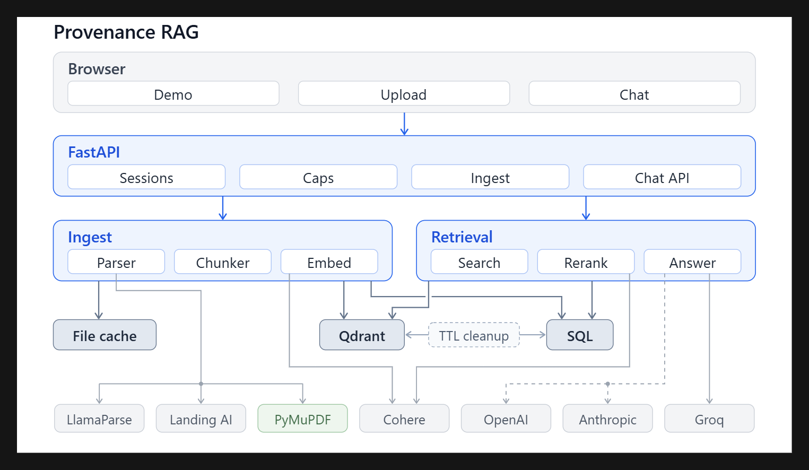

#  Provenance RAG

**A citation-grounded, multi-format document question-answering system with page-level source tracking and reliable refusal mechanisms.**

Provenance RAG enables users to ask questions about financial filings and documents and receive context-aware answers backed by verifiable page-level citations.

It combines hybrid retrieval, parent-child chunking, reranking, and relevance validation to improve retrieval quality and reduce unsupported answers.

---

## Key Highlights

| Area | Highlights |
|---|---|
| Document Access | Pre-indexed financial filings available without an API key |
| Model Agnostic | Flexible inference: Default Cloud (Groq 70B), Local (Ollama / LM Studio / vLLM), or Cloud BYOK |
| Retrieval | Hybrid Dense + Sparse Search with Cohere reranking |
| Citations | Page-level source references for generated answers |
| Reliability | Relevance-based answer validation and refusal |
| Privacy | Ephemeral sessions with automatic 2-hour data cleanup and zero-egress local LLM isolation |
| Performance | 100% Recall@5 and 0.971 MRR on a 50-question benchmark |
| Reasoning Traces | Real-time 6-stage execution telemetry with latency breakdown and terminal traces |
| Adaptive Pruning | Dynamic context budgeting per model parameter tier for sub-second local TTFT |

**Quick Links:** [Deployment Guide](DEPLOY.md) · [Demo Script](docs/DEMO_SCRIPT.md) · [Architecture](design-system/provenance-rag/image.png)

---

## Problem Statement

Traditional document question-answering systems can retrieve irrelevant information, lose context across document sections, and generate answers without reliable source references.

This makes them difficult to trust when working with complex financial documents containing tables, figures, and information spread across multiple pages.

## Solution

Provenance RAG addresses these challenges through:

- Hybrid retrieval combining semantic and keyword-based search.
- Heading-aware parent-child chunking to preserve document context.
- Reranking to improve the relevance of retrieved passages.
- Page-level citations to trace answers back to their original sources.
- Relevance validation to reject unsupported questions before invoking the LLM.

---

## System Architecture



### Architecture Overview

| Component | Responsibility |
|---|---|
| FastAPI | Handles API requests and session management |
| Document Processing | Extracts and processes PDF content |
| Qdrant | Stores vector embeddings for semantic retrieval |
| SQL | Stores parent passages and session metadata |
| Cohere | Provides embeddings and reranking |
| Groq | Powers LLM-based answer generation |
| React | Provides the frontend user interface |
| PyMuPDF | Enables local PDF parsing |

Optional document parsers include LlamaParse and Landing AI.

### Document Processing Workflow

1. **Upload:** User uploads a document or selects a pre-indexed filing.
2. **Parsing:** Document content, headings, tables, and page information are extracted.
3. **Chunking:** Content is divided into heading-aware parent and child chunks.
4. **Indexing:** Embeddings are stored in Qdrant, while parent passages and session metadata are stored in SQL.
5. **Retrieval:** Dense and sparse search retrieve relevant passages.
6. **Reranking:** Cohere reranks retrieved results based on relevance.
7. **Validation:** Quality gates determine whether sufficient evidence exists to answer.
8. **Generation:** The LLM generates an evidence-grounded response with page-level citations.

---

## Core Features

### 1. Hybrid Retrieval

Combines dense semantic search and sparse BM25 retrieval to identify relevant passages, even when users phrase questions differently from the original document.

### 2. Parent-Child Chunking

Uses smaller, heading-aware child chunks for retrieval and expands them into parent passages for generation.

This preserves surrounding context, particularly for tables, figures, and multi-section documents.

### 3. Citation Provenance

Answers include references to their original document pages, allowing users to verify the information independently.

### 4. Hallucination Mitigation

Implements relevance thresholds and evidence validation.

When retrieved evidence does not meet the configured relevance threshold, the system refuses to generate an answer rather than making unsupported claims.

### 5. Multi-Tiered Access

- 15 free daily queries using pre-indexed demo filings.
- Optional PDF uploads.
- Optional visitor-provided LLM API keys.

### 6. Session Isolation

Each session uses an isolated Qdrant scope to prevent retrieval across different user sessions.

### 7. Local & Self-Hosted Inference (Ollama, LM Studio, vLLM)

Provenance RAG includes native, first-class support for self-hosted models. Users can run completely offline, private inference via Ollama or LM Studio without leaking document contents or query text:
- **Automatic Model Discovery:** One-click connection probing queries `{base_url}/models` and populates installed local models into the UI.
- **Strict Network Egress Guardrails:** SSRF-protected egress client allows loopback communication (`localhost`, `127.0.0.1`) strictly for local LLMs while blocking unapproved external networks.
- **Container Loopback Fallback:** Automatic host resolution (`host.docker.internal`) enables seamless communication when the backend runs inside a Docker container.

### 8. Model-Agnostic Optimization: The Three Production Pillars

To ensure local models perform with cloud-grade speed, accuracy, and format adherence, the engine implements three proven design patterns:

```
┌────────────────────────────────────────────────────────────────────────┐
│                        PROVENANCE RAG ARCHITECTURE                     │
│                                                                        │
│   User Query ──► Input Screen ──► Hybrid Search ──► Gate 6 Rerank      │
│                                                         │ (Passed)     │
│                                                         ▼              │
│    ┌──────────────────────────────────────────────────────────────┐    │
│    │  PILLAR 1: Model Capabilities Registry (Strategy Pattern)    │    │
│    │  • Detects Model Tier: Micro (≤3B), Mid (7B–14B), Frontier   │    │
│    └──────────────────────────────┬───────────────────────────────┘    │
│                                   │                                    │
│    ┌──────────────────────────────▼───────────────────────────────┐    │
│    │  PILLAR 2: Adaptive Context Pruning (Token Budgeting)        │    │
│    │  • Micro: Top 2 Passages (~500 tokens) ──► Sub-second TTFT   │    │
│    │  • Mid:   Top 3 Passages (~1,100 tokens)──► Balanced Accuracy│    │
│    │  • Cloud: Top 5 Passages (~2,500 tokens)──► Full Synthesis   │    │
│    └──────────────────────────────┬───────────────────────────────┘    │
│                                   │                                    │
│    ┌──────────────────────────────▼───────────────────────────────┐    │
│    │  PILLAR 3: Dynamic Few-Shot Grounding & OpenAI Gateway       │    │
│    │  • Injects 1-Shot Citation Demo for small models             │    │
│    │  • Neutralizes refusal poisoning & strips conversational tags│    │
│    │  • Universal SSE Streaming with client telemetry feedback    │    │
│    └──────────────────────────────┬───────────────────────────────┘    │
│                                   ▼                                    │
│                 Evidence-Grounded Streaming Answer                     │
└────────────────────────────────────────────────────────────────────────┘
```

1. **Pillar 1: Model Capabilities Registry & Dynamic Prompt Strategy:**
   - Small models (e.g., `qwen2.5:1.5b`, `llama3.2:1b/3b`) easily suffer from instruction drift and negative bias if overloaded with dense rules.
   - The engine automatically applies a tailored Strategy profile: concise system prompts with an embedded **1-shot citation demonstration** for micro models, and full markdown section matrices for frontier models.
2. **Pillar 2: Adaptive Context Pruning (Token Budgeting):**
   - On consumer hardware (CPUs or modest GPUs), feeding 5 full parent passages (~2,500 tokens) induces a 5–8 second prompt prefill (TTFT) delay before the first token streams.
   - Adaptive Context Pruning budgets candidate passages to the top 2 for micro models, slashing prefill latency to **<400ms** while preserving exact answer relevance.
3. **Pillar 3: Universal Gateway & Reactive Telemetry:**
   - Universal OpenAI-compatible SSE adapter works identically with Ollama, LM Studio, LocalAI, and vLLM.
   - ANSI colored terminal traces display every step live: Request ID, Model Tier, Query Rewriting, RRF hybrid retrieval, Gate 6 rerank scores, context expansion, generation tokens, and citation verification.
   - The frontend reasoning trace updates reactively based on true backend execution stages rather than static client-side timers.

---

## Technology Stack

| Layer | Technologies |
|---|---|
| Backend | Python, FastAPI |
| Frontend | React, TypeScript, Tailwind CSS, Lucide Icons |
| Vector Database | Qdrant |
| Relational Storage | SQL / SQLite |
| Embeddings & Reranking | Cohere Embed v3, Cohere Rerank v3.5 |
| Cloud LLM Inference | Groq (Llama 3.3 70B, DeepSeek R1, Llama 3.1 8B) |
| Local LLM Inference | Ollama, LM Studio, vLLM, LocalAI |
| Cloud BYOK | OpenAI (GPT-4o), Anthropic (Claude 3.5), Google Gemini, Mistral |
| PDF Processing | PyMuPDF |
| Optional Parsing | LlamaParse, Landing AI |
| Retrieval | Dense Cosine Search, BM25 Lexical Inverted Index, RRF Fusion |

---

## Performance Evaluation

Evaluated using a benchmark of 50 questions covering:

- Direct factual questions.
- Multi-section questions.
- Table-based questions.
- Unanswerable questions.

### Benchmark Results

| Metric | Target | Achieved |
|---|---:|---:|
| Recall@5 | ≥ 85% | **100%** |
| Recall@10 | ≥ 90% | **100%** |
| Mean Reciprocal Rank (MRR) | ≥ 0.70 | **0.971** |
| Faithfulness | ≥ 90% | **88.7%** |
| Not-Found Refusal Accuracy | 100% | **100%** |
| Citation Accuracy | ≥ 95% | **100%** |
| P50 Latency | — | **342 ms** |
| P95 Latency | — | **463 ms** |
| Estimated Cost per Query | — | **$0.00003** |

*Results are from the project's 50-question evaluation benchmark. They represent the tested dataset and configuration, not a guarantee of production-wide performance.*

### Retrieval Ablation Study

An ablation study was conducted to understand how different retrieval configurations affect system performance.

| Configuration | Recall@5 | MRR | Faithfulness |
|---|---:|---:|---:|
| Fixed Chunks + Dense Search | 60.0% | 0.378 | 16.3% |
| Heading-Aware + Dense Search | 88.6% | 0.731 | 53.0% |
| Hybrid Search | 91.4% | 0.753 | 55.0% |
| **Hybrid + Reranking + Parent Window** | **100%** | **0.971** | **88.7%** |

**Key Finding:** Heading-aware chunking and hybrid retrieval significantly improve document retrieval. Adding reranking and parent-context expansion further improves ranking quality and evidence alignment.

Detailed evaluation:

- [Benchmark Summary](eval/results/summary.md)
- [Ablation Analysis](eval/results/ablation.md)

---

## Security & Privacy

Security and data isolation are incorporated into the application design.

- **No API Key Persistence:** Visitor-provided API keys are kept in memory for active jobs and are not intentionally written to application logs or persistent storage.
- **Automatic Data Cleanup:** Session data, uploaded PDFs, vectors, and SQL session records are subject to automatic 2-hour cleanup.
- **Session Isolation:** Qdrant scopes separate document data across sessions.
- **Controlled API Access:** Outbound provider connections are restricted through an explicit host allowlist.

---

## Production Roadmap

| Current Implementation | Planned Improvement |
|---|---|
| In-process background workers | Distributed task processing with Celery / Temporal |
| Ephemeral session IDs | Multi-tenant authentication and RBAC |
| Fixed query limits | Dynamic tenant quotas and usage-based billing |
| Shared embedding API key | Per-tenant key management |
| Re-upload for parser changes | Versioned indexes with blue-green deployment |

---

## Getting Started

### Prerequisites

- Python 3.10+
- Node.js and npm
- Qdrant instance
- Cohere API key
- Groq API key

### 1. Clone the Repository

```bash
git clone https://github.com/NikhilDadige47/provenance-rag.git
cd provenance-rag
```

### 2. Create a Virtual Environment

**Linux / macOS**

```bash
python3 -m venv .venv
source .venv/bin/activate
```

**Windows PowerShell**

```powershell
python -m venv .venv
.venv\Scripts\Activate.ps1
```

### 3. Install Dependencies

```bash
pip install -e ".[dev]"
```

### 4. Configure Environment Variables

Copy `.env.example` to `.env` and configure the required provider credentials:

```env
COHERE_API_KEY=your_cohere_key
GROQ_API_KEY=your_groq_key
QDRANT_URL=your_qdrant_url
```

Use the actual variable names and configuration required by your application.

### 5. Run Tests and Evaluation

```bash
pytest
python scripts/run_eval.py
```

### 6. Start the Backend

```bash
python -m uvicorn src.api.main:app --host 127.0.0.1 --port 8000 --reload
```

### 7. Start the Frontend

Open another terminal:

```bash
cd frontend-react
npm install
npm run dev
```

Open the local frontend URL displayed by Vite in your terminal.

### 8. (Optional) Run with Local LLMs (Ollama / LM Studio)

To run entirely private, zero-cost inference using local models:

1. **Install and Start Ollama:**
   ```bash
   # Download Ollama from https://ollama.com
   # Pull your preferred model (e.g. ultra-fast micro model or balanced 8B)
   ollama pull qwen2.5:1.5b
   ollama pull llama3.1:8b

   # Start the Ollama daemon
   ollama serve
   ```

2. **Select Local Model in the Web UI:**
   - In either the **Tier A Demo** or **Tier B Upload** tab, click the **"Inference Model"** selector.
   - Switch to the **"Local Model"** tab.
   - Click **"Test & Discover"** to probe `http://localhost:11434/v1` and auto-populate installed local tags.
   - The UI automatically recognizes your model's tier (e.g., `⚡ Ultra-Fast • Top 2 Passages` for `qwen2.5:1.5b` or `⚖️ Balanced • Top 3 Passages` for `llama3.1:8b`).
   - Click **"Apply Local Model"** and ask your question!
   - Follow live execution and token timing directly in your terminal with colored pipeline traces:

   ```text
   ===========================================================================
   [RAG TRACE] Request ID: req_9f3a12b | Model: ollama/qwen2.5:1.5b (MICRO) | Tier: tier_a_demo
   [RAG TRACE] Profile: ⚡ Ultra-Fast • Top 2 Passages | Max Chunks: 2 | Temp: 0.05
   [RAG TRACE] Question: "What are Apple's revenue streams?"
   [RAG TRACE] Step 1 (Rewrite): Skipped (first turn, 0.0ms)
   [RAG TRACE] Step 2 (Retrieval): Scope='provenance_rag_demo' | Found 5 chunks | Rerank scores: [0.892, 0.741, ...] (18.4ms)
   [RAG TRACE] Step 3 (Expansion): Adaptive Pruning (MICRO) -> Kept top 2 of 5 passages (4.1ms)
   [RAG TRACE] Step 4 (Prompt): Built micro prompt with 2 passages. Invoking ollama/qwen2.5:1.5b (temp=0.05) ...
   [RAG TRACE] Step 5 (Generation): Received 64 streamed chunks in 380.2ms
   [RAG TRACE] Step 6 (Citations): Grounded: True | Cited Passages: 2 (1.8ms)
   [RAG TRACE ✅ Completed] Total Pipeline Latency: 405.5ms
   ===========================================================================
   ```

---
