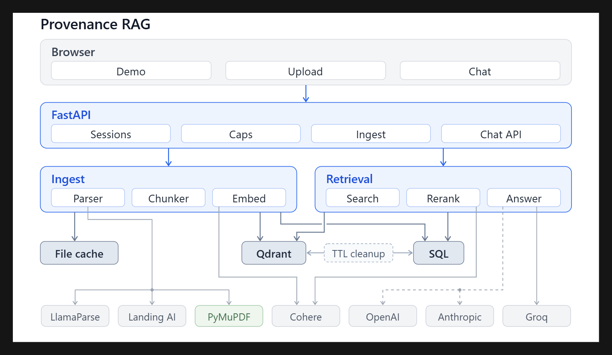

#  Provenance RAG

> Document QA system featuring page-level citation provenance, multi-format retrieval, and deterministic hallucination prevention.

| Feature | Details |
|---|---|
| **Access** | Pre-stored filings available instantly (no API key required). |
| **Privacy** | Ephemeral sessions with automatic 2-hour TTL data wipe. User keys remain in memory only. |
| **Performance** | **100%** Recall@5, **0.971** MRR, **100%** Not-Found refusal accuracy (50-question benchmark). |
| **Cost Control** | Strict quality & relevance gates prevent unnecessary LLM invocations. |

* **Deploy:** [DEPLOY.md](DEPLOY.md) | **Demo Script:** [docs/DEMO_SCRIPT.md](docs/DEMO_SCRIPT.md)

---

## 🏗️ Architecture



* **API Layer:** FastAPI handles all incoming requests and session routing.
* **Ingestion & Storage:** Documents are parsed, chunked, and embedded into **Qdrant** (vectors) and **SQL** (parent passages/sessions). Automatic 2-hour TTL wipe removes both.
* **Embeddings & Reranking:** Powered by **Cohere**.
* **Generation:** Default LLM is **Groq**. Optional support for **OpenAI** and **Anthropic** via temporary visitor keys.
* **Parsing:** Local **PyMuPDF** (no key) with optional **LlamaParse** or **Landing AI**.

---

## ⚡ Technical Decisions & Architecture

* **Multi-Tiered Access:** 15 free daily queries over demo filings without entering an API key. Optional PDF uploads and custom LLM keys.
* **Scoped Embeddings:** Embeddings and reranking run on a central Cohere key with per-session caps. Vectors are isolated by session `scope` in Qdrant to prevent cross-tenant access.
* **Parent-Child Chunking:** Ranks small, heading-aware child chunks via dense (Cohere) + sparse (BM25) hybrid search. Expands context to parent chunks for LLM generation so tables and figures stay aligned with their headings.
* **Quality & Relevance Gates:** Flags poor document parses before indexing. Queries falling below the relevance cutoff score refuse to answer and **never call the LLM**.
* **SSRF Prevention:** Adapters call a strictly enforced allowlist of host URLs.

---

## 📊 Benchmark & Ablation

Evaluated on 50 questions across financial filings (direct facts, multi-section queries, tables, and unanswerable trick questions).

| Metric | Target | Result | Description |
|---|---:|---:|---|
| **Recall@5** | ≥ 85% | **100%** | Correct page in top 5 retrieved |
| **Recall@10** | ≥ 90% | **100%** | Correct page in top 10 retrieved |
| **MRR** | ≥ 0.70 | **0.971** | Mean Reciprocal Rank of target page |
| **Faithfulness** | ≥ 90% | **88.7%** | Labeled keyword overlap (deterministic) |
| **Not-Found Accuracy** | 100% | **100%** | Trick questions successfully refused |
| **Citation Accuracy** | ≥ 95% | **100%** | Cited IDs present in retrieved passages |
| **P50 / P95 Latency** | — | **342 ms / 463 ms** | End-to-end local evaluation run |
| **Cost per Query** | — | **$0.00003** | Token cost estimate |

### Retrieval Ablation Impact

| Configuration | Recall@5 | Recall@10 | MRR | Faithfulness | Not-Found Refusal |
|---|---:|---:|---:|---:|---:|
| Fixed Chunks (Dense Only) | 60.0% | 65.7% | 0.378 | 16.3% | 0% |
| Heading-Aware Chunks (Dense Only) | 88.6% | 91.4% | 0.731 | 53.0% | 0% |
| Hybrid (Dense + Sparse) | 91.4% | 100% | 0.753 | 55.0% | 0% |
| **Hybrid + Rerank + Parent Window** | **100%** | **100%** | **0.971** | **88.7%** | **100%** |

> **Key Takeaway:** Heading-aware chunking boosts Recall@5 from 60% to 89%. Reranking elevates MRR to 0.971 and enables 100% refusal accuracy on unanswerable queries.

*Detailed analysis:* [eval/results/summary.md](eval/results/summary.md) | [eval/results/ablation.md](eval/results/ablation.md)

---

## 🔑 Security & Key Management

* **Zero Key Persistence:** Visitor API keys are processed in-memory for the active job/session and never written to logs, SQLite, or disk.
* **Data Isolation:** Uploaded PDFs, vectors, and SQL session rows are automatically deleted after 2 hours, on explicit session end, or upon user deletion request.
* **Egress Allowlisting:** Backend outbound connections are restricted to explicit vendor API hosts.

---

## 🛠️ Production Roadmap

| Current Implementation | Production Target |
|---|---|
| In-process background worker | Distributed task queue (Celery/Temporal) with retries |
| Ephemeral session IDs | Multi-tenant Auth with RBAC & chunk access checks |
| Fixed per-session query caps | Dynamic tenant quotas & usage-based billing |
| Shared owner embedding key | Per-tenant key vaults or enterprise API gateway |
| Re-upload to change parser | Versioned collection indexes with blue/green swap |

---

## 🚀 Quickstart

### 1. Environment Setup

```powershell
python -m venv .venv
.venv\Scripts\Activate.ps1
pip install -e ".[dev]"
2. Run Evaluation & Tests
PowerShell
python scripts/run_eval.py
pytest
3. Start Backend & Frontend
Copy .env.example to .env and set owner API keys (COHERE_API_KEY, GROQ_API_KEY, QDRANT_URL).

PowerShell
# Terminal 1: Backend API
python -m uvicorn src.api.main:app --host 127.0.0.1 --port 8000 --reload

# Terminal 2: Frontend Client
cd frontend-react
npm install
npm run dev
